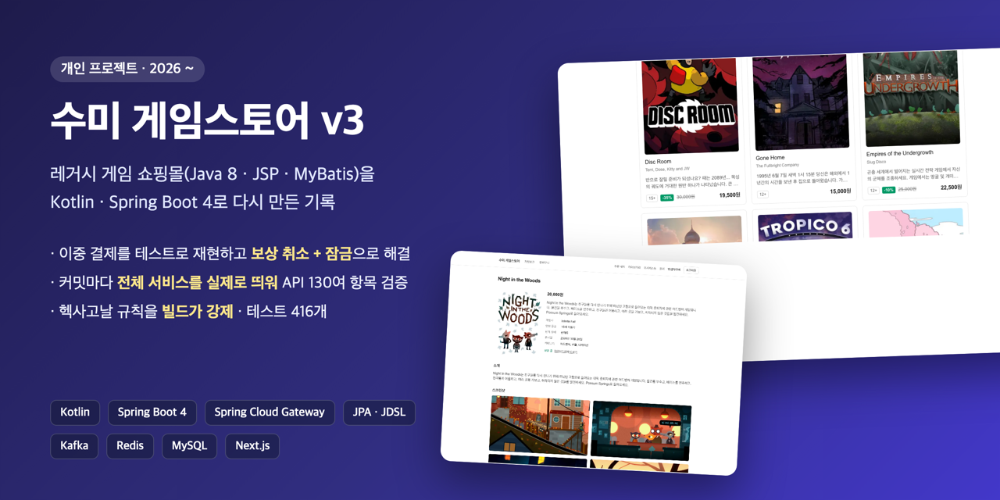

# 수미 게임스토어 v3 위키

예전에 만든 게임 쇼핑몰(Java 8, Spring Boot 2.7, JSP, MyBatis)을 **Kotlin과 Spring Boot 4로 처음부터 다시 만들고 있는** 개인 프로젝트의 설계·개발 기록입니다.

**📖 위키 사이트: https://hanej93.github.io/sumy-gamestore-wiki/**

> 코드는 비공개입니다. 코드 열람이 필요하시면 요청해 주세요.

| 항목 | 내용 |
|---|---|
| 백엔드 | Kotlin 2.2 · Spring Boot 4.0 · Spring Cloud Gateway · JPA + Kotlin JDSL · Kafka · Redis · MySQL |
| 프론트엔드 | Next.js 16 · React 19 · TypeScript |
| 테스트 | 백엔드 테스트 416개, 실제 기동 후 API 확인 130여 항목, 프론트 E2E 20개 시나리오 |
| 배포 | Docker · Helm(EKS 기준) · GitHub Actions |

## 바로 가기
- [프로젝트 소개](docs/overview/index.md) · [화면](docs/overview/screens.md)
- [아키텍처](docs/backend/architecture.md) · [기능별 문서](docs/backend/domains/index.md)
- [기술 결정](docs/engineering/tech-decisions.md) · [품질](docs/engineering/quality.md) · [AI 협업](docs/engineering/ai-workflow.md)
- [트러블슈팅](docs/troubleshooting/index.md) · [작업 이력](docs/history/index.md)

화면의 게임 이미지는 이전 버전 프로젝트에서 쓰던 자료로, 저작권은 각 게임 개발사·배급사에 있습니다. 포트폴리오 설명 목적으로만 씁니다.
