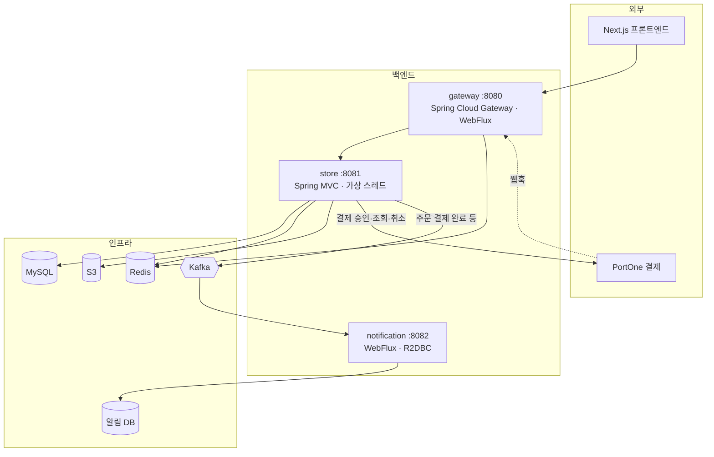
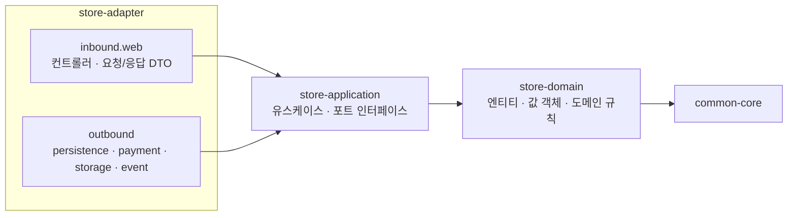
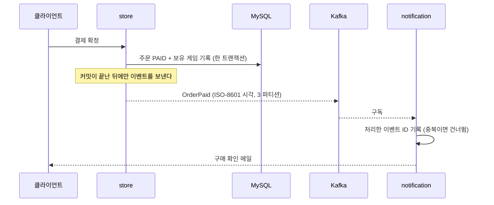

# 아키텍처

이 문서는 **지금 동작하는 구조**를 설명합니다. 다음 단계에서 바꿀 구조는 [로드맵](../overview/roadmap.md)에 따로 적었습니다.

## 1. 서비스 구성

| 서비스 | 하는 일 | 스택을 고른 이유 |
|---|---|---|
| gateway | 외부 진입점. 라우팅, 레이트리밋, 소셜 로그인 경로 전달 | 요청을 넘기기만 해서 블로킹이 없다. 적은 스레드로 많은 연결을 다루는 WebFlux가 맞다 |
| store | 회원·카탈로그·주문·결제·리뷰·문의·관리자 기능 | JPA가 블로킹이다. WebFlux에 넣으면 이벤트 루프가 막히므로 MVC를 쓰고, 가상 스레드로 처리량을 확보한다 |
| notification | Kafka 이벤트를 받아 알림을 저장하고 메일을 보낸다 | 이벤트 소비와 I/O뿐이라 리액티브가 이득이다. 블로킹 JDBC를 들이지 않으려고 R2DBC를 쓴다 |

리액티브를 쓰는 곳과 쓰지 않는 곳을 일부러 나눴습니다. 경계는 의존성 규칙으로 막아 두었습니다. store에는 WebFlux를, notification에는 JPA를 넣지 않습니다.

## 2. store 내부: 헥사고날 구조

- **store-domain에는 프레임워크 의존이 없습니다.** 스프링, JPA, Jackson, Kafka를 import하면 빌드가 실패합니다.
- **store-application은 포트만 선언합니다.** PG, 저장소, 메시지 브로커가 무엇인지 모릅니다.
- **어댑터끼리는 서로를 참조하지 않습니다.** 결제 어댑터가 영속성 어댑터를 직접 부르지 않고 포트를 거칩니다.

이 규칙은 문서가 아니라 **빌드가 강제합니다.**
1. Gradle 모듈 경계: 안쪽 모듈은 바깥 모듈을 의존성에 넣을 수 없습니다.
2. 아키텍처 테스트(Konsist): import 방향, 클래스 이름 규칙(예: 컨트롤러는 inbound.web에만), 어댑터 간 참조를 검사합니다. 위반하면 CI가 막습니다.

### 쿼리 규칙
- 단순 조회는 Spring Data JPA를 씁니다.
- 조건이 붙거나 조인·집계가 필요한 쿼리는 **Kotlin JDSL**로 씁니다. 값이 없는 조건은 쿼리에 넣지 않습니다(`listOfNotNull`). 레거시 카탈로그 필터 버그의 원인이 이것이었습니다.

## 3. 이벤트 흐름

- **커밋 뒤에만 발행합니다.** 커밋 전에 보내면 롤백된 일이 알림으로 나갑니다.
- **소비자는 멱등입니다.** 같은 이벤트가 두 번 와도 한 번만 처리합니다. 유니크 제약이 있는 처리 이력 테이블로 막습니다.
- **와이어 포맷은 한 곳에서 정합니다.** 발행 쪽과 구독 쪽이 같은 직렬화 설정을 쓰도록 공용 모듈에 두었습니다. 따로 두었다가 실제로 어긋난 적이 있습니다([트러블슈팅 1](../troubleshooting/01-it-compiles-but.md)).
- **읽을 수 없는 메시지 하나가 소비를 막지 않게** 역직렬화 오류를 처리기로 감쌌습니다.
- 지금은 커밋 직후 앱이 직접 발행합니다. 이 방식은 커밋과 발행 사이에 앱이 죽으면 이벤트를 잃을 수 있습니다. 다음 단계에서 **아웃박스 테이블 + Debezium**으로 바꿉니다([로드맵](../overview/roadmap.md)).

## 4. 여러 대로 띄운다는 전제

모든 서비스는 두 대 이상 뜨는 것을 전제로 짰습니다.

| 문제 | 해결 |
|---|---|
| 로그인 세션 | Spring Session + Redis. 어느 인스턴스로 가도 로그인이 유지됩니다 |
| 결제 확정과 취소가 동시에 들어옴 | Redis 주문 단위 잠금 + DB 낙관적 락(`@Version`)을 함께 씁니다. 잠금이 만료돼도 DB가 마지막에 막습니다 |
| 스케줄 작업(미확정 결제 대사) | ShedLock으로 한 인스턴스만 실행합니다 |
| 레이트리밋 | 게이트웨이의 Redis 리미터. 키는 로그인 세션, 없으면 신뢰 프록시를 거친 클라이언트 IP입니다 |
| Kafka 소비 | 컨슈머 그룹으로 파티션을 나눠 받습니다. 발행 쪽과 구독 쪽이 같은 파티션 수로 토픽을 선언합니다 |

## 5. 오류 응답

모든 오류는 RFC 9457 **ProblemDetail** 형식입니다. 검증 오류는 `errors[{field, message}]`로 필드별 메시지를 줍니다.
프론트엔드는 OpenAPI 스펙에서 타입을 생성하고, 스펙이 실제 응답과 다르지 않은지 스크립트로 검사합니다(nullable 표시, 오류 형식, 자유형 맵 금지).

## 6. 배포

- Docker 멀티 스테이지 빌드. 레이어를 의존성과 애플리케이션 코드로 나눠 캐시를 살리고, 숫자 UID로 실행합니다.
- Helm 차트는 필수 접속 정보가 비어 있으면 렌더링 단계에서 실패합니다. 빈 값으로 배포된 뒤 파드가 죽는 것보다 먼저 막는 편이 낫기 때문입니다. `latest` 태그는 거부합니다(롤백이 성립하지 않음).
- 차트는 lint, 렌더링, 쿠버네티스 스키마 검증(kubeconform)까지 스크립트로 확인합니다.
