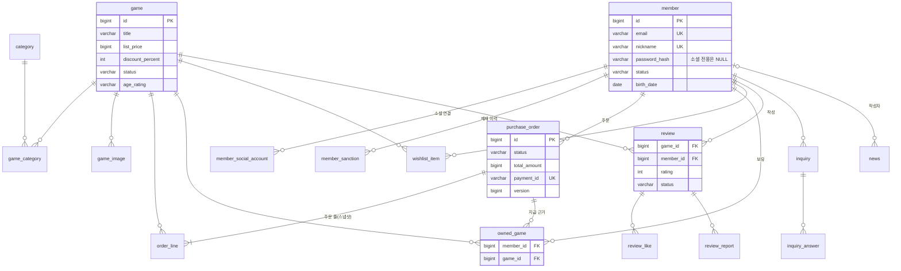

# 데이터 모델

store DB(MySQL)의 주요 테이블과 관계, Flyway 마이그레이션 이력을 정리했습니다. 알림 서비스는 별도 스키마를 씁니다.

## 전체 ERD

주요 테이블과 관계만 그렸습니다. 컬럼은 핵심만 남겼고, 도메인별 상세는 각 [도메인 문서](domains/index.md)에 있습니다.

알림 서비스 스키마(`sumy_notification`)에는 `processed_event` 한 테이블만 있습니다. store 테이블과 공유하지 않습니다(D05).

## 중요한 제약

| 제약 | 막는 것 |
|---|---|
| `owned_game (member_id, game_id)` 유니크 | 같은 게임 중복 지급. 동시 결제 확정의 마지막 방어선 |
| `purchase_order.payment_id` 유니크 | 결제 하나가 두 주문에 붙는 것 |
| `purchase_order.version` | 확정과 취소가 동시에 저장될 때 나중 저장이 덮어쓰는 것(낙관적 락) |
| `order_line (order_id, game_id)` 유니크 | 한 주문에 같은 게임 두 번 |
| `review (game_id, member_id)` 유니크 | 한 게임에 리뷰 여러 개 |
| `review_like`, `review_report`, `wishlist_item`의 (대상, 회원) 유니크 | 좋아요·신고·담기 중복 |
| `member.email`, `member.nickname` 유니크 | 같은 이메일·닉네임 회원 |
| 금액·할인율·별점·상태값 CHECK | 애플리케이션 버그가 잘못된 값을 넣는 것 |

## 설계 원칙

- **스키마 변경은 Flyway로만 합니다.** JPA `ddl-auto`는 `validate`로 고정해, 엔티티와 스키마가 어긋나면 기동이 실패합니다.
- **이미 적용된 마이그레이션은 고치지 않습니다.** Flyway 체크섬은 주석까지 포함합니다. 적용된 파일의 주석 한 줄만 고쳤는데 기동이 막힌 적이 있어, 고칠 일이 생기면 새 버전을 추가합니다(V5, V6, V9가 그 예입니다).
- **MySQL `ENUM` 대신 `VARCHAR` + `CHECK`를 씁니다.** `ENUM`은 값 추가가 DDL 변경이고, 레거시는 표시 문자열(`'12세'`)을 그대로 저장했습니다.
- **시각은 `DATETIME(6)`, UTC로 저장합니다.** 레거시는 서버 타임존에 기대고 있었습니다.
- **반복 컬럼 대신 자식 테이블을 둡니다.** 레거시의 카테고리 4칸, 이미지 5칸, 문의 이미지 3칸을 모두 없앴습니다.
- **카운터 대신 행을 셉니다.** 좋아요 수, 신고 수, 경고 수는 행이 진실이고 수는 계산 결과입니다.
- **삭제 대신 상태를 바꾸는 곳이 있습니다.** 리뷰(신고 이력이 참조), 회원 탈퇴(주문 이력이 참조)가 그렇습니다.
- **외래키에 삭제 동작을 명시합니다.** 레거시는 13개 외래키 모두 동작이 없어 서비스가 자식 삭제 순서를 손으로 관리했습니다.
- **개인정보는 필요한 것만 받습니다.** 주소·전화번호·성별·실명 컬럼을 만들지 않았고, 소셜 토큰은 저장하지 않습니다.

## 마이그레이션 이력

### store (`db/migration/store`)

| 버전 | 내용 |
|---|---|
| V1 | 카탈로그 기본 테이블: `category`, `game`, `game_category`, `game_image` |
| V3 | 회원: `member`, `member_social_account` |
| V6 | 연령 등급 값을 enum 이름(`ALL`, `TWELVE` ...)으로 정규화하고 CHECK 추가 |
| V7 | 주문·결제·보유: `purchase_order`, `order_line`, `owned_game` |
| V8 | 위시리스트: `wishlist_item` |
| V10 | 리뷰·신고·제재: `review`, `review_like`, `review_report`, `member_sanction` |
| V11 | 문의·소식: `inquiry`, `inquiry_answer`, `news` |
| V12 | 매출 집계용 커버링 인덱스 `(status, paid_at, member_id, total_amount)` |
| V13 | 운영 환경에 들어갔을 수 있는 로컬 시드 회원을 무력화(비밀번호 제거, 권한 회수, 탈퇴 처리) |
| V14 | 주문 낙관적 락 `version` 컬럼 |
| V15 | 스케줄 분산 잠금 `shedlock` 테이블(ShedLock 공식 정의) |
| V16 | 미확정 주문 대사용 인덱스 `(status, ordered_at)` |

### 로컬 시드 (`db/seed/local/store`, `local` 프로파일에서만 적용)

| 버전 | 내용 |
|---|---|
| V2 | 카탈로그 시드. 이미지는 공개 플레이스홀더 주소 |
| V4 | 회원 시드(레거시 개인정보는 옮기지 않음) |
| V5 | V4 시드 회원의 비밀번호 해시 교정 |
| V9 | 시드 이미지 주소에 확장자 추가(확장자가 없으면 SVG가 와서 프론트에서 막힘) |

버전 번호가 비어 보이는 것은 시드를 별도 위치로 옮겼기 때문입니다. 처음에는 시드가 운영 마이그레이션과 같은 위치에 있어, 그 시절 배포된 환경에 비밀번호가 문서에 공개된 관리자 계정이 들어갈 수 있었습니다. 시드를 `local` 전용 위치로 옮기고, 이미 들어간 시드 회원은 지우지 않고 V13으로 무력화했습니다(D36). 주문·리뷰가 그 회원을 참조할 수 있어 삭제하지 않았습니다.

### notification (`db/migration/notification`)

| 버전 | 내용 |
|---|---|
| V1 | `processed_event`: 처리한 이벤트 ID(유니크). 중복 메일 방지 |

## 관련 문서
- [기능 지도](domains/index.md)
- [API 개요](api.md)
- [모듈 구조](modules.md)
- [아키텍처](architecture.md)
