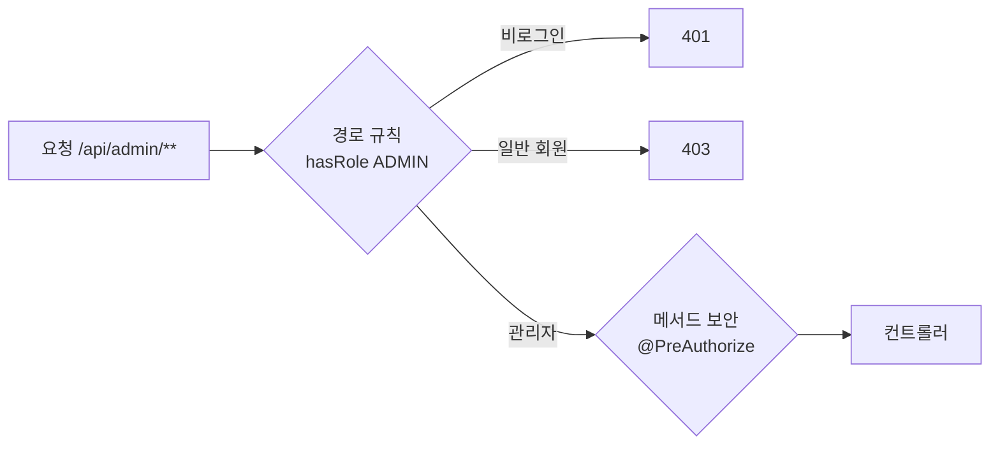

# 관리자 기능

카탈로그·회원·신고·문의·소식 운영과 매출 집계를 `/api/admin/**` 아래에 모았습니다. 엔드포인트는 31개(경로 26개)이고, 권한 검사가 새지 않는지 스모크가 스펙에서 전부 뽑아 확인합니다.

## 엔드포인트 묶음

| 묶음 | 기본 경로 | 수 | 하는 일 | 자세히 |
|---|---|---|---|---|
| 카탈로그 | `/api/admin/catalog` | 9 | 게임 등록·수정·판매 시작·중지·이미지 교체, 카테고리 CRUD | [카탈로그](catalog.md) |
| 회원 | `/api/admin/members` | 5 | 검색, 상세(제재 이력 포함), 정지·해제, 권한 변경 | [회원·인증](member.md) |
| 리뷰 신고 | `/api/admin/reviews` | 4 | 대기 신고 목록, 수용, 반려, 가린 리뷰 복구 | [리뷰·신고](review-report.md) |
| 고객 지원 | `/api/admin/support` | 10 | 문의 목록·답변·종료, 소식 작성·수정·공개·비공개·삭제 | [문의·공지](inquiry-news.md) |
| 매출 | `/api/admin/sales` | 3 | 기간 요약, 일자별, 게임별 순위 | 아래 |

수는 컨트롤러의 매핑 애노테이션을 직접 센 값입니다. 관리자 전용 게임 목록 엔드포인트는 따로 없습니다.

## 권한 검사

- **두 겹으로 막습니다.** 보안 설정의 경로 규칙과 컨트롤러 클래스의 `@PreAuthorize("hasRole('ADMIN')")`입니다. 경로 규칙 한 줄이 실수로 빠져도 메서드가 막습니다.
- **`@EnableMethodSecurity`를 반드시 켭니다.** 빠지면 `@PreAuthorize`가 조용히 무시돼, 권한 검사가 있는 것처럼 보이지만 없는 상태가 됩니다.
- **권한 거부 예외는 전역 예외 처리기가 삼키지 않고 다시 던집니다.** 처음에는 모든 예외를 잡는 처리기가 권한 거부를 500으로 바꾸고 있었습니다. 실제로 띄워 보고 발견했습니다.

### 전수 스모크

`scripts/admin-authz-check.py`가 실행 중인 앱의 OpenAPI 스펙(`/v3/api-docs`)에서 `/api/admin`으로 시작하는 엔드포인트를 **모두 뽑아** 비로그인은 401, 일반 회원은 403인지 확인합니다. 경로 변수는 아무 값(1)으로 채웁니다. 권한 검사는 리소스를 찾기 전에 끝나기 때문입니다.

엔드포인트를 손으로 나열하지 않는 이유는, 관리자 API가 늘 때마다 하나씩 빠뜨리고 빠진 그 하나가 열려 있어도 아무도 모르기 때문입니다. 레거시가 그랬습니다. 스펙에서 뽑으면 앞으로 추가되는 엔드포인트도 자동으로 검사 대상이 됩니다.

## 회원 관리

- **검색은 JDSL로 6가지 조건을 받습니다.** 이메일(부분), 닉네임, 상태, 권한, 가입 기간(시작·끝). 정렬은 가입일 순·역순, 이메일, 닉네임입니다.
- **목록에서는 이메일을 마스킹하고, 상세에서만 전체를 보여줍니다.** 관리자 화면 캡처 한 장으로 전체 회원 이메일이 새는 것을 막습니다.
- **정지는 사유가 필수이고 만료 시각은 선택입니다.** 상태 변경과 제재 이력을 같은 트랜잭션에서 남깁니다. 따로 쓰면 "정지됐는데 사유가 없는" 회원이 생깁니다.
- **해제하면 효력이 남은 정지 이력을 철회 처리합니다.** 이력 자체는 지우지 않습니다. 언제 풀었는지가 감사 기록입니다.
- **정지·권한 변경 직후 그 회원의 세션을 모두 끊습니다.** 스모크가 정지 직후 기존 쿠키로 `/api/auth/me`가 401이 되는 것을 확인합니다.
- **자기 자신의 관리자 권한 해제는 409입니다.**

## 매출 집계

| API | 내려주는 것 |
|---|---|
| `GET /api/admin/sales/summary` | 매출액, 결제 건수, 판매 수량, 구매자 수, 객단가 |
| `GET /api/admin/sales/daily` | 일자별 매출액·건수. 매출이 없는 날도 0으로 채움 |
| `GET /api/admin/sales/games` | 게임별 매출액·판매 수 순위(페이지) |

- **결제 완료(`PAID`) 주문만 셉니다.** 대기·취소·실패 주문은 돈이 들어온 적이 없습니다.
- **기간은 한국 시간 기준 반열림 구간입니다.** `from 00:00 KST` 이상, `(to + 1일) 00:00 KST` 미만입니다. `<= 23:59:59`로 쓰면 마이크로초 구간이 빠집니다. 기간을 비우면 최근 30일이고, 최대 366일입니다. 상한이 없으면 전체 기간 집계 한 번으로 DB가 멈출 수 있습니다.
- **요약은 쿼리 두 개로 나눕니다.** 판매 수량은 `order_line`을 조인해야 나오는데, 한 쿼리로 합치면 주문이 줄 수만큼 복제돼 매출액과 건수가 부풀려집니다.
- **매출 없는 날은 DB가 아니라 애플리케이션에서 0으로 채웁니다.** SQL로 만들려면 달력 테이블이나 재귀 CTE가 필요합니다. 기간 상한이 있어 비용이 작습니다. 빠진 날을 건너뛰면 그래프의 추세가 왜곡됩니다.
- **집계용 커버링 인덱스를 추가했습니다(V12).** 기존 인덱스는 `member_id`가 앞이라 `status + paid_at` 조건에 쓰이지 못하고 풀스캔이었습니다. `(status, paid_at, member_id, total_amount)`로 요약 쿼리가 테이블 본문을 읽지 않습니다.

## 레거시에서 무엇이 문제였고 어떻게 바꿨나

| 레거시 | 지금 |
|---|---|
| `/admin/**`만 경로로 막고 나머지는 `permitAll()`, 규칙 한 줄이 주석 처리되면 전부 열림 | 기본 닫힘 + 경로 규칙 + 메서드 보안 + 스펙 기반 전수 스모크 |
| 블랙리스트 플래그와 경고 횟수를 직접 수정, 사유·기간 없음 | 정지·해제가 제재 이력을 남기고 세션까지 끊음 |
| 관리자 메모·경고 횟수 변경을 `POST`로 조회 | 조회는 `GET`, 상태 변경은 동사형 `POST .../suspend` |
| 아무 동작 없이 200을 돌려주는 빈 엔드포인트 2개 | 없음 |
| 회원 삭제 API가 바인딩되지 않는 파라미터를 받아 엉뚱한 대상을 지움 | 삭제 대신 정지·탈퇴(상태 전이)로 설계 |
| 대시보드·통계 기능 없음, 판매수·누적수익을 게임 행에 비정규화해 동시성 보호 없이 갱신 | `PAID` 주문을 그때그때 집계 |

## 테스트로 보장하는 것

- `SalesQueryJdslAdapterTest`(10개)가 실제 MySQL에서 기간 경계, `PAID`만 집계, 조인 중복 없는 합계를 확인하고, `SalesQueryServiceTest`(8개)가 0원인 날 채우기와 기간 검증을 확인합니다.
- 스모크가 관리자 경로 전체의 401·403, 정지 후 세션 회수, 자기 강등 409, 일자별 매출 구간의 연속성을 실제 앱에서 확인합니다.

## 관련 결정

| 번호 | 내용 |
|---|---|
| D06 | 회원 검색·매출 집계는 Kotlin JDSL |
| D17 | 오류 응답 스키마는 한 곳에서 ProblemDetail로 채움 |
| D40 | 세션 주체 이름을 회원 식별자로 통일해 정지 시 세션 회수 |

## 관련 문서
- [기능 지도](index.md)
- [API 개요](../api.md)
- [품질을 지키는 방법](../../engineering/quality.md)
