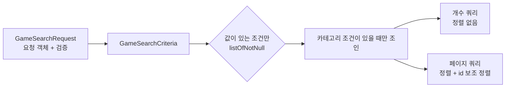
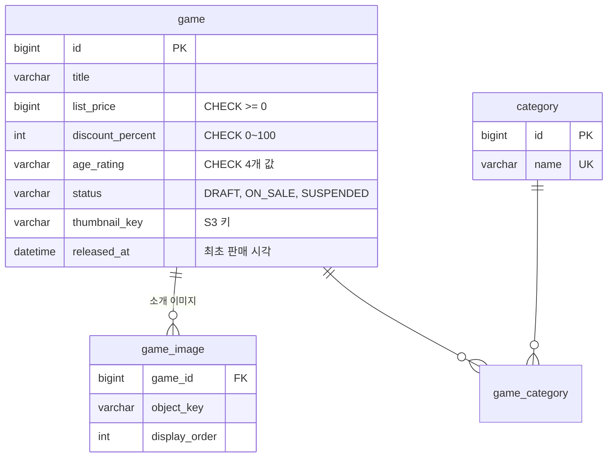

# 카탈로그

게임, 카테고리, 소개 이미지, 할인, 판매 상태를 관리하고, 로그인 없이 쓰는 목록 검색을 제공합니다.

## 주요 기능

| 기능 | 설명 |
|---|---|
| 게임 목록 검색 | 제목 검색어, 카테고리(여러 개), 가격 구간, 판매 중만 보기, 정렬 5종, 페이지 |
| 게임 상세 | 목록 정보에 상세 설명과 소개 이미지를 더해 내려줍니다 |
| 카테고리 목록 | 검색 필터용. 로그인 없이 조회합니다 |
| 게임 관리 | 등록, 수정, 판매 시작, 판매 중지, 이미지 교체(관리자) |
| 카테고리 관리 | 생성, 이름 변경, 삭제(관리자) |
| 이미지 업로드 | 서버가 S3 서명 URL을 발급하고 브라우저가 직접 올립니다 |

## 핵심 규칙

- **판매 상태는 `DRAFT → ON_SALE ⇄ SUSPENDED`입니다.** 새로 등록한 게임은 항상 `DRAFT`입니다. 등록과 동시에 판매되면 미완성 정보가 노출됩니다.
- **판매를 시작하려면 상세 설명, 대표 이미지, 카테고리가 모두 있어야 합니다.**
- **출시 시각은 처음 판매를 시작한 시각만 기록합니다.** 중지 후 다시 판매해도 바뀌지 않습니다. 바뀌면 최신순 정렬이 흔들립니다.
- **판매가는 도메인이 계산합니다.** `정가 × (100 − 할인율) / 100`, 원 단위 미만은 버립니다. 할인율은 0~100입니다. 금액은 부동소수점 없이 원 단위 정수(`Long`)로만 다룹니다.
- **연령 등급은 코드값(`ALL`, `TWELVE`, `FIFTEEN`, `EIGHTEEN`)으로 저장합니다.** 표시 문구는 애플리케이션이 정합니다. 구매 시점의 연령 확인은 [회원](member.md)·[주문](order-payment.md) 문서에 있습니다.
- **이미지 순서 번호는 서버가 매기고 중복될 수 없습니다.** 순서가 겹치면 정렬이 비결정적이 됩니다. 개수 제한은 없습니다.
- **쓰는 게임이 있는 카테고리는 삭제할 수 없습니다(409).** 외래키가 막기 전에 이유를 먼저 알려줍니다. 카테고리 이름은 1~50자이고 중복될 수 없습니다.
- **업로드 파일 이름은 저장 키로 쓰지 않습니다.** 키는 `용도/UUID.확장자`로 서버가 만듭니다. 경로 탈출과 덮어쓰기를 막습니다. 허용 형식은 JPEG·PNG·WebP·GIF이고, 서명 URL은 5분 뒤 만료됩니다.
- **DB에는 S3 오브젝트 키만 저장합니다.** 공개 주소는 설정의 기준 URL과 조립합니다. 호스팅 위치를 바꿔도 데이터를 고치지 않아도 됩니다.

## 검색 필터: Kotlin JDSL

조건이 동적으로 붙는 목록 검색은 Kotlin JDSL로 씁니다(D06). 기준 구현이 `GameSearchJdslAdapter`입니다.

- **값이 없는 조건은 쿼리에 넣지 않습니다.** 빈 문자열 검색어도 조건에서 빠집니다. 레거시 카탈로그 필터 버그는 문자열 SQL을 이어 붙이다 빈 값 처리를 놓친 것이었습니다.
- **카테고리 조건이 없으면 조인하지 않습니다.** 조인했을 때 생기는 중복 행은 `selectDistinct`로 걷어냅니다.
- **정렬 마지막에 항상 `id`를 붙입니다.** 같은 정렬값이 여러 건이면 페이지 경계에서 같은 게임이 두 번 나오거나 빠집니다.
- **개수 쿼리에는 정렬을 걸지 않습니다.** 결과가 0건이면 페이지 쿼리를 아예 보내지 않습니다.
- 가격 구간 필터는 정가 기준입니다. `RELEVANCE` 정렬은 검색 엔진의 몫이라 지금은 최신순과 같게 동작합니다.
- 엔티티 속성 참조(`GameJpaEntity::listPrice`)로 쿼리를 쓰므로 필드 이름을 바꾸면 컴파일이 깨집니다. 문자열 SQL이 없어 SQL 인젝션 경로도 없습니다.

## 대표 API

| 메서드 | 경로 | 설명 |
|---|---|---|
| GET | `/api/games` | 목록 검색. `keyword`, `categoryIds`, `minPrice`, `maxPrice`, `onSaleOnly`(기본 true), `sort`, `page`, `size`(1~100) |
| GET | `/api/games/{gameId}` | 상세 |
| GET | `/api/categories` | 카테고리 목록 |
| POST | `/api/uploads` | 업로드 서명 URL 발급(로그인 필요) |
| POST | `/api/admin/catalog/games` | 게임 등록(항상 DRAFT) |
| POST | `/api/admin/catalog/games/{gameId}/publish` | 판매 시작 |
| PUT | `/api/admin/catalog/games/{gameId}/images` | 이미지 목록 교체(순서는 보낸 순서) |

관리자 API 전체는 [관리자 기능](admin.md)에 있습니다.

## 데이터 모델

인덱스는 판매 상태와 함께 최신순(`status, released_at`)과 가격순(`status, list_price`)을 받도록 두었습니다.

## 레거시에서 무엇이 문제였고 어떻게 바꿨나

| 레거시 | 지금 |
|---|---|
| 카테고리 컬럼 4개 고정(`game_category_id1~4`), 필터 쿼리가 4중 `OR` | `game_category` 조인 테이블. 개수 제한 없음 |
| 소개 이미지 컬럼 5개 고정 | `game_image` 테이블. 순서가 값으로 존재 |
| 연령 등급을 `enum('전체','12세',...)` 표시 문자열로 저장 | 코드값 저장 + CHECK 제약 |
| 파일명을 그대로 저장, 업로드 파일명이 서로 덮어씀 | S3 오브젝트 키, UUID 키 생성 |
| 업로드 로직 4곳 중복, 확장자·크기 검증 없음 | 포트 하나(`FileStoragePort`) 뒤 어댑터 하나, 형식 허용 목록 |
| 게임 수정 시 파일을 안 올리면 썸네일이 `null`로 덮여 유실 | 새 키가 없으면 기존 값을 유지 |
| 할인가 계산을 JSP와 여러 컨트롤러에 흩어 둬 화면마다 값이 다름 | `Game.salePrice` 한 곳 |
| 페이지 파라미터를 검증 없이 `parseInt` | 요청 객체 + `@Min`/`@Max` 검증, 400 |

## 테스트로 보장하는 것

- `GameTest`(22개)가 판매 시작 조건, 최초 출시 시각 유지, 판매가 계산을 고정합니다.
- `GameSearchJdslAdapterTest`(14개)는 실제 MySQL(Testcontainers)에서 조건 조합, 빈 조건 제외, 페이지 경계 정렬을 확인합니다. 업로드는 스모크가 서명 URL 발급부터 실제 PUT 왕복까지 확인합니다.

## 관련 결정

| 번호 | 내용 |
|---|---|
| D06 | 조건부·조인·집계 쿼리는 Kotlin JDSL, Spring Data JPA는 단순 조회만 |
| D08 | 영속성 테스트는 Testcontainers MySQL, H2 금지 |
| D11 | 검색 포트를 저장 포트와 분리(검색 엔진 교체 대비) |
| D13 | 로컬 S3는 LocalStack |

## 관련 문서
- [기능 지도](index.md)
- [관리자 기능](admin.md)
- [데이터 모델](../data-model.md)
- [아키텍처: 쿼리 규칙](../architecture.md)
