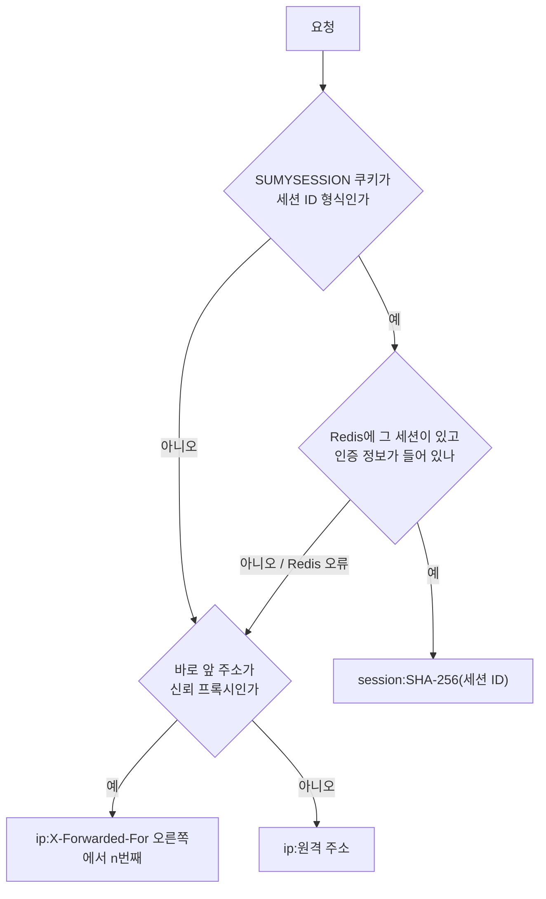

# 게이트웨이

프론트와 PG 웹훅이 들어오는 유일한 입구입니다. Spring Cloud Gateway(WebFlux)로 요청을 store에 넘기고, Redis 레이트리밋과 프록시 헤더 정리를 맡습니다. 인증은 하지 않습니다.

## 주요 기능

| 기능 | 설명 |
|---|---|
| 라우팅 | `/api/**`와 소셜 로그인 경로(`/oauth2/**`, `/login/oauth2/**`)를 store로 넘깁니다 |
| 레이트리밋 | Redis 토큰 버킷. 키는 "인증된 세션, 없으면 클라이언트 IP"입니다 |
| 프록시 헤더 | 신뢰하는 프록시에서 온 `X-Forwarded-*`만 넘기고, 나머지는 지웁니다 |
| 추적 ID | 요청마다 `X-Trace-Id`를 새로 만들어 store로 넘기고 응답에도 붙입니다 |
| CORS | 허용 출처를 환경변수로 받고 쿠키 전송을 허용합니다 |

## 라우트

| ID | 경로 | 대상 | 필터 |
|---|---|---|---|
| `store-api` | `/api/**` | store | 레이트리밋 |
| `store-oauth2` | `/oauth2/**`, `/login/oauth2/**` | store | 레이트리밋 |

모든 라우트에 공통으로 `RemoveRequestHeader=X-User-Id`와 `PreserveHostHeader`를 겁니다. 게이트웨이 자체 API는 없고 Actuator(헬스·메트릭)만 엽니다.

## 핵심 규칙

- **게이트웨이는 인증하지 않습니다. store가 세션을 직접 검증합니다.** "게이트웨이가 인증하고 `X-User-Id`를 붙여 넘긴다"는 구조는 store가 헤더를 무조건 믿는다는 뜻입니다. store에 직접 닿는 경로가 하나라도 있으면 헤더를 위조해 아무 계정이나 될 수 있습니다. 그래서 클라이언트가 보낸 `X-User-Id`는 들어오는 길에서 지워 둡니다.
- **원래 `Host`를 store로 넘깁니다(`PreserveHostHeader`).** store가 만드는 소셜 로그인 콜백 주소(`redirect_uri`)가 store 내부 주소가 아니라 공급자에 등록한 공개 주소가 되게 합니다.
- **신뢰 프록시(`trusted-proxies`)에서 온 요청의 `X-Forwarded-*`만 믿습니다.** 기본값은 사설 대역과 루프백입니다. 맞지 않으면 게이트웨이가 그 헤더를 지웁니다.
- **`X-Forwarded-For`는 덧붙이고, `Proto`·`Port`·`Host`는 게이트웨이가 쓰지 않습니다.** 앞단(ALB) 값을 그대로 넘깁니다. 게이트웨이가 쓰면 `https,http`처럼 섞여 store가 https를 잃습니다. RFC 7239 `Forwarded` 헤더는 끕니다. 두 형식을 함께 보내면 받는 쪽마다 해석이 달라집니다.
- **게이트웨이의 Boot 프록시 헤더 처리(`forward-headers-strategy`)는 `none`입니다.** Boot의 처리는 보낸 쪽을 가리지 않고 `X-Forwarded-For` 첫 값(위조 가능)으로 원격 주소를 바꿉니다. 그러면 신뢰 판단이 클라이언트 주소로 이뤄집니다. store는 `native`로 두어 게이트웨이가 넘긴 값을 씁니다.
- **클라이언트가 보낸 추적 ID는 믿지 않습니다.** 게이트웨이가 항상 새로 만듭니다.

## 레이트리밋 키

- **쿠키 값만으로 사용자를 가르지 않습니다.** 그러면 아무 값이나 넣어 버킷을 무한히 만들 수 있습니다. 쿠키가 가리키는 세션이 Redis에 실제로 있고 인증 정보가 있을 때만 세션 단위로 셉니다. 세션 내용(직렬화된 인증 정보)은 열지 않고 해시 필드가 있는지만 봅니다.
- **세션 ID는 비밀이라 Redis 키에는 SHA-256으로만 남깁니다.**
- **IP는 `X-Forwarded-For`의 첫 값이 아니라 오른쪽에서 n번째(우리 프록시가 덧붙인 값)를 씁니다.** 첫 값은 클라이언트가 마음대로 적을 수 있습니다. n은 앞단 프록시 홉 수(기본 1)입니다. 헤더는 직접 파싱하지 않고 Spring Cloud Gateway의 `XForwardedRemoteAddressResolver`를 씁니다.
- **기본 한도는 초당 20, 버스트 40입니다.** 카운터가 Redis에 있어 게이트웨이를 여러 대로 늘려도 한도가 공유됩니다.
- **한계:** 회원이 아니라 세션 단위라, 로그인을 여러 번 하면 버킷도 여러 개가 됩니다. 로그인 자체는 IP 버킷에 묶여 있어 한도가 몇 배 늘어나는 정도입니다. 회원 단위로 세려면 게이트웨이가 인증 주체를 알아야 합니다(D40).

## 소셜 로그인 경로

| 용도 | 경로(게이트웨이 기준) |
|---|---|
| 로그인 시작(브라우저 이동) | `GET /oauth2/authorization/kakao`, `GET /oauth2/authorization/naver` |
| 공급자 콜백(공급자 콘솔에 등록) | `GET /login/oauth2/code/kakao`, `GET /login/oauth2/code/naver` |
| 성공·실패 후 이동 | 환경변수로 지정한 프론트 주소 |

처리는 store의 Spring Security가 합니다. 게이트웨이에 이 라우트가 없으면 게이트웨이를 거친 소셜 로그인은 404였습니다. 앞단이 `X-Forwarded-Proto: https`를 주면 콜백 주소가 `https://...`로 만들어지는 것을 실제로 띄워 확인했습니다.

## 이전에 무엇이 문제였고 어떻게 바꿨나

| 이전 | 지금 |
|---|---|
| 레거시: 단일 애플리케이션, 요청 수 제한 없음 | 게이트웨이의 Redis 레이트리밋 |
| 레거시: 요청 본문의 `userId`를 믿어 계정 탈취 | 신원은 store가 세션으로만 판단, `X-User-Id`는 제거 |
| 초기 설계: 게이트웨이가 인증하고 `X-User-Id`를 붙여 전달 | 헤더를 믿는 구조를 버리고 store가 세션 검증 |
| 초기 구현: 레이트리밋 키가 원격 주소. ALB 뒤에서는 ALB 주소라 전 사용자가 버킷 몇 개를 나눠 씀 | 인증 세션 > 신뢰 프록시 뒤 클라이언트 IP |
| 초기 구현: 소셜 로그인 경로 라우트 없음 | `store-oauth2` 라우트 + `PreserveHostHeader` |

## 테스트로 보장하는 것

- `GatewayRoutingIntegrationTest`(5개)는 실제 게이트웨이 + Redis + WireMock store로 세션별·IP별 버킷 분리, 위조 쿠키는 IP 버킷으로 가는 것, 소셜 라우트와 `Host`·`X-Forwarded-Proto` 전달, `X-User-Id`·`Forwarded` 제거를 확인합니다.
- `RateLimitKeyResolverTest`(5개)는 신뢰하지 않는 주소가 보낸 `X-Forwarded-For` 무시, 오른쪽 값 사용, Redis 오류 시 IP로 내려가는 것을 확인합니다.
- 이 테스트가 가끔 실패하던 원인을 찾아 결정적으로 바꾼 과정은 [트러블슈팅 3](../../troubleshooting/03-flaky-rate-limit-test.md)에 있습니다.

## 관련 결정

| 번호 | 내용 |
|---|---|
| D03 | 블로킹이 없는 게이트웨이는 WebFlux |
| D04 | 배포 단위 3개(gateway, store, notification)로 시작 |
| D40 | 프록시 헤더는 SCG `trusted-proxies`, 레이트리밋 키는 인증 세션 > 클라이언트 IP |

## 관련 문서
- [트러블슈팅 3: 가끔만 실패하는 레이트리밋 테스트](../../troubleshooting/03-flaky-rate-limit-test.md)
- [회원·인증](member.md) (소셜 로그인)
- [아키텍처: 여러 대로 띄운다는 전제](../architecture.md)
