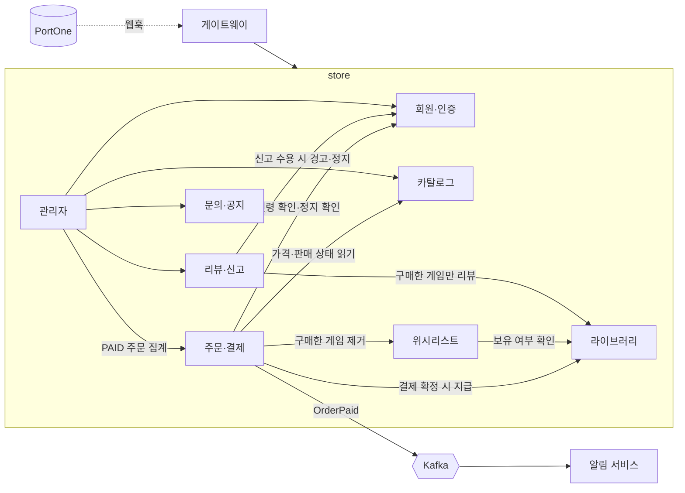

# 기능 지도

백엔드가 제공하는 기능을 도메인 단위로 나눠 정리했습니다. 지금은 store 한 서비스 안에서 패키지로 경계를 나누고, 게이트웨이와 알림은 별도 서비스로 떼어 두었습니다.

## 도메인 목록

| 도메인 | 하는 일 | 위치 | API 수 | 문서 |
|---|---|---|---|---|
| 회원·인증 | 가입, 세션 로그인, 소셜 로그인, 생년월일, 정지·권한 | store `member` | 5 | [member.md](member.md) |
| 카탈로그 | 게임·카테고리·이미지·할인·판매 상태, 검색 필터 | store `catalog` | 3 | [catalog.md](catalog.md) |
| 주문·결제 | 주문 생성, 결제 확정·취소, 웹훅, 미확정 주문 대사 | store `order` | 6 | [order-payment.md](order-payment.md) |
| 라이브러리·위시리스트 | 보유 게임, 담아두기 | store `order`·`wishlist` | 6 | [library-wishlist.md](library-wishlist.md) |
| 리뷰·신고 | 리뷰, 좋아요, 신고, 제재 | store `review` | 7 | [review-report.md](review-report.md) |
| 문의·공지 | 1:1 문의와 답변, 소식(공지) | store `support` | 5 | [inquiry-news.md](inquiry-news.md) |
| 관리자 | 위 도메인의 운영 기능, 매출 집계 | store `/api/admin/**` | 31 | [admin.md](admin.md) |
| 알림 | Kafka 이벤트를 받아 메일 발송 | notification 서비스 | 없음 | [notification.md](notification.md) |
| 게이트웨이 | 라우팅, 레이트리밋, 프록시 헤더, 소셜 로그인 경로 | gateway 서비스 | 없음(전달만) | [gateway.md](gateway.md) |

API 수는 컨트롤러의 매핑 애노테이션을 직접 센 값입니다(사용자용만, 관리자는 따로). 업로드 URL 발급 1개는 카탈로그·회원 공용이라 표에서 뺐습니다. 전체 수치는 [API 개요](../api.md)에 있습니다.

## 도메인 사이의 관계

- **주문이 중심입니다.** 결제가 확정되는 한 트랜잭션에서 주문 상태 변경, 라이브러리 지급, 위시리스트 정리가 함께 일어납니다.
- **라이브러리(보유 게임)는 여러 규칙의 근거입니다.** 중복 구매 차단, 위시리스트 담기 차단, 리뷰 작성 자격이 모두 보유 여부를 봅니다.
- **제재는 회원 상태와 세션까지 바꿉니다.** 신고를 받아들이면 작성자에게 경고가 쌓이고, 임계치를 넘으면 정지와 함께 열린 세션을 끊습니다.
- **서비스 사이는 이벤트로만 연결됩니다.** 알림 서비스는 store DB를 보지 않고 `OrderPaid` 이벤트만 받습니다.

!!! note "다음 단계의 구조"
    store를 member / catalog / order / payment / review / support 서비스로 나누는 계획이 있습니다(결정 D21). 이 문서의 도메인 구분이 그 경계와 거의 같습니다. 아직 구현 전이며 [로드맵](../../overview/roadmap.md)에 정리했습니다.

## 관련 문서
- [아키텍처](../architecture.md)
- [API 개요](../api.md)
- [데이터 모델](../data-model.md)
- [모듈 구조](../modules.md)
