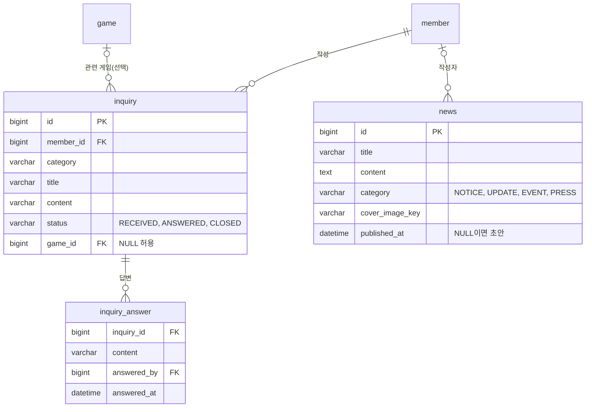

# 문의·답변·공지

회원이 1:1 문의를 남기면 관리자가 답변하고 종료합니다. 공지·업데이트·이벤트 소식은 초안으로 쓰고 공개 시점을 정해 내보냅니다.

## 주요 기능

| 기능 | 설명 |
|---|---|
| 문의 등록 | 분류 6종(결제, 환불, 계정, 게임 문제, 신고, 기타), 제목, 내용, 관련 게임(선택) |
| 내 문의 목록·상세 | 목록은 최신순 요약, 본문과 답변은 상세에서 |
| 답변·종료 | 관리자가 답변을 여러 번 쌓을 수 있고, 답변이 있어야 종료할 수 있습니다 |
| 소식 목록·상세 | 로그인 없이 봅니다. 분류(공지, 업데이트, 이벤트, 보도) 필터 |
| 소식 관리 | 초안 작성, 수정, 공개, 공개 취소, 삭제(관리자) |

## 핵심 규칙

### 문의

- **상태는 `RECEIVED → ANSWERED → CLOSED`입니다.** 답변하면 `ANSWERED`가 되고, 추가 답변도 계속 쌓입니다.
- **답변이 하나도 없는 문의는 종료할 수 없습니다.** 답하지 않고 닫으면 사용자는 왜 닫혔는지 알 수 없습니다.
- **종료된 문의에는 답변할 수 없습니다.**
- **답변은 별도 테이블에 누가, 언제 답했는지와 함께 남깁니다.**
- **문의는 항상 로그인한 회원 기준으로 조회합니다. 남의 문의는 404입니다.** 결제 문의에는 주문번호나 연락처가 적힙니다. 403이면 그 번호의 문의가 있다는 사실이 새어 나갑니다.
- **관리자 대기 목록은 오래된 순입니다.** 최신순이면 묵은 문의가 계속 뒤로 밀립니다. 기본 필터는 미답변(`RECEIVED`)입니다.
- 제목 200자, 내용·답변 각 4,000자까지입니다.

### 소식

- **글은 항상 초안으로 만들어집니다.** 작성 중인 글이 공개되면 안 됩니다.
- **공개 여부는 `published_at` 하나로 표현합니다.** `NULL`이면 초안, 과거 시각이면 공개, 미래 시각이면 예약 공개입니다.
- **공개 경로는 `published_at`이 지금 이전인 글만 보여줍니다.** 초안이나 예약 시각 전인 글의 상세는 404입니다.
- **공개 조건은 한 함수에만 둡니다.** 목록 쿼리와 개수 쿼리가 조건을 복사하면 한쪽만 고쳤을 때 "3건이라는데 2건만 나오는" 버그가 됩니다.
- **수정은 공개 여부를 바꾸지 않습니다.** 공개된 글을 고치면 공개 상태 그대로 내용만 바뀝니다. 공개를 내리면 초안으로 돌아갑니다.
- 소식 공개 목록만 Kotlin JDSL로 씁니다(분류 선택이 동적이고 시각 조건이 섞이기 때문). 나머지 목록은 조건이 고정이라 Spring Data 메서드로 둡니다.

## 대표 API

| 메서드 | 경로 | 설명 |
|---|---|---|
| POST | `/api/inquiries` | 문의 등록. 201 |
| GET | `/api/inquiries` | 내 문의 목록. 페이지 봉투 |
| GET | `/api/inquiries/{inquiryId}` | 내 문의 상세(답변 포함). 남의 것은 404 |
| GET | `/api/news` | 공개 소식 목록. `category` 필터 |
| GET | `/api/news/{newsId}` | 공개 소식 상세 |
| GET | `/api/admin/support/inquiries` | 상태별 문의 목록(관리자) |
| POST | `/api/admin/support/inquiries/{inquiryId}/answers` | 답변(관리자) |
| POST | `/api/admin/support/inquiries/{inquiryId}/close` | 종료(관리자) |
| POST | `/api/admin/support/news` | 소식 초안 작성(관리자) |
| POST | `/api/admin/support/news/{newsId}/publish` | 공개(관리자) |

관리자 소식 API 7개 전체는 [관리자 기능](admin.md)에 있습니다.

## 데이터 모델

인덱스는 화면 조회 방식에 맞췄습니다. 내 문의 `(member_id, created_at DESC)`, 관리자 대기열 `(status, created_at ASC)`, 공개 소식 `(published_at DESC)`와 `(category, published_at DESC)`입니다. 관련 게임이 지워지면 문의의 `game_id`만 `NULL`이 됩니다.

## 레거시에서 무엇이 문제였고 어떻게 바꿨나

| 레거시 | 지금 |
|---|---|
| 문의 상세를 식별자만으로 열 수 있어 남의 문의가 보임 | 항상 로그인 회원 기준, 남의 것은 404 |
| 문의 등록에 로그인 확인이 없고 `userId`를 폼에서 받음 | 로그인 필수, 회원은 세션에서 |
| 상태가 "읽음 여부" 불리언 하나라 대기 목록을 만들 수 없음 | 상태 기계(접수 → 답변 → 종료) |
| 답변이 문의 행의 컬럼이라 누가 언제 답했는지, 추가 답변 이력이 없음 | `inquiry_answer` 테이블 |
| 이미지 컬럼 3개 고정, 업로드 로직을 컨트롤러에 다시 구현 | 첨부는 두지 않음. 필요하면 별도 테이블로 추가 |
| 아무 동작 없이 200을 돌려주는 빈 엔드포인트 | 없음 |
| 소식 목록 쿼리에 공개 조건이 없어 작성 중인 글이 노출 | 초안·예약 공개, 공개 조건 한 곳 |
| 수정 시 파일을 안 올리면 썸네일이 `null`로 덮여 유실 | 새 이미지 키가 없으면 기존 값 유지 |
| `news_list` 인덱스가 PK뿐 | 공개 목록·관리자 대기열 인덱스 |

!!! note "답변 메일"
    레거시는 답변을 메일로도 보냈습니다. 지금은 답변을 저장하고 회원이 상세 화면에서 확인합니다. 답변 메일 알림은 아직 없습니다.

## 테스트로 보장하는 것

- `SupportTest`(17개)가 답변 없는 종료 차단, 종료 후 답변 차단, 초안·예약 공개 판정을 고정합니다.
- 스모크가 실제 앱에서 남의 문의 404, 초안이 공개 목록·상세에 안 보이는 것, 공개를 내린 뒤 다시 404가 되는 것을 확인합니다.

## 관련 결정

| 번호 | 내용 |
|---|---|
| D06 | 동적 조건(소식 공개 목록)만 JDSL, 고정 조건은 Spring Data |
| D16 | 사용자 노출 문자열은 메시지 파일에, 로케일은 한국어 고정 |
| D33 | 목록은 공통 페이지 봉투 |

## 관련 문서
- [기능 지도](index.md)
- [관리자 기능](admin.md)
- [데이터 모델](../data-model.md)
