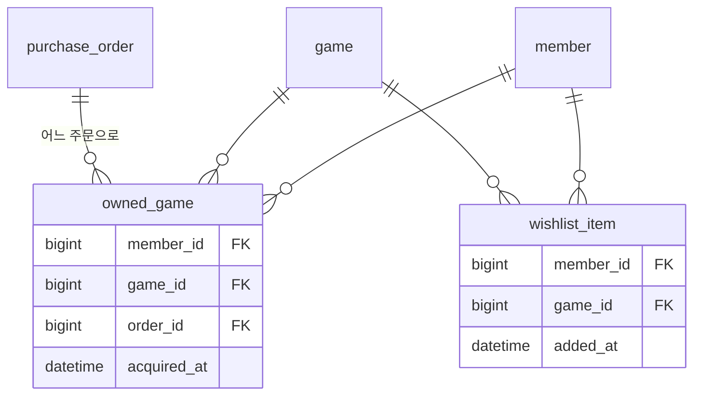

# 라이브러리·위시리스트

라이브러리는 결제가 확정된 보유 게임 목록이고, 위시리스트는 나중에 살 게임을 담아 두는 목록입니다. 레거시에서 한 테이블로 겸용하던 "장바구니"와 "담아두기"를 나눴습니다.

## 주요 기능

| 기능 | 설명 |
|---|---|
| 내 라이브러리 | 결제가 확정된 게임을 최근에 얻은 순으로 보여줍니다 |
| 보유 여부 확인 | 상세 화면에서 "구매하기"와 "라이브러리에서 실행"을 가르는 데 씁니다 |
| 위시리스트 담기·빼기 | 담기는 `PUT`이라 같은 요청을 다시 보내도 결과가 같습니다 |
| 위시리스트 목록 | 최근에 담은 것이 먼저 나옵니다 |
| 담김 여부 확인 | 상세 화면의 담기 버튼 상태를 정합니다 |

## 핵심 규칙

- **라이브러리에는 결제 확정으로만 들어갑니다.** 주문 확정과 같은 트랜잭션에서 `owned_game`에 행을 넣습니다([주문·결제](order-payment.md)).
- **한 회원은 같은 게임을 한 번만 보유합니다.** `(member_id, game_id)` 유니크 제약이 동시 확정까지 막습니다.
- **이미 보유한 게임은 위시리스트에 담을 수 없습니다(409).**
- **위시리스트는 회원당 200개까지입니다.**
- **이미 담긴 게임을 다시 담으면 409입니다.** 담기를 `PUT`으로 두어 재시도는 안전하게 하되, 이미 담긴 경우는 구분해 알려줍니다. 프론트는 204와 409를 모두 "담긴 상태"로 처리합니다.
- **결제가 확정되면 산 게임을 위시리스트에서 자동으로 뺍니다.** 남아 있으면 사용자가 또 담긴 줄 알고 혼란스러워합니다. 이미 없으면 조용히 넘어가므로 재처리에 안전합니다.
- **저장할 때 바뀐 항목만 반영합니다.** 전부 지우고 다시 넣으면 `added_at`이 초기화돼 최근순 정렬이 망가집니다.
- **장바구니 테이블은 두지 않습니다.** 주문 생성이 곧 장바구니 확정이고, 담아두기는 위시리스트가 맡습니다.
- 모든 경로는 로그인이 필요하고, 회원 식별자는 세션에서 가져옵니다.

## 대표 API

| 메서드 | 경로 | 설명 |
|---|---|---|
| GET | `/api/library` | 내 보유 게임. 페이지 봉투 |
| GET | `/api/library/games/{gameId}` | 보유 여부 `{ owned }` |
| GET | `/api/wishlist` | 내 위시리스트. 페이지 봉투 |
| PUT | `/api/wishlist/games/{gameId}` | 담기. 204, 이미 담김·보유·상한은 409 |
| DELETE | `/api/wishlist/games/{gameId}` | 빼기. 204 |
| GET | `/api/wishlist/games/{gameId}` | 담김 여부 `{ inWishlist }` |

값 하나만 돌려주는 응답도 맵이 아니라 이름 있는 DTO(`OwnershipResponse`, `WishlistStatusResponse`)로 만들었습니다(D18). 맵으로 두면 생성된 TypeScript 타입이 인덱스 시그니처가 되어 오타를 잡지 못합니다.

!!! warning "정리할 부분"
    두 목록 API는 아직 `page`·`size`를 낱개 파라미터로 받고, 범위를 벗어난 값을 400 대신 조용히 보정합니다. 주문 목록은 요청 객체 + 400으로 정리했고(D33), 이 두 곳은 같은 정리 대상으로 남겨 두었습니다. 레거시 라이브러리에 있던 제목 검색과 정렬 4종도 아직 옮기지 않았습니다.

## 데이터 모델

- `owned_game`: `(member_id, game_id)` 유니크, `(member_id, acquired_at DESC)` 인덱스.
- `wishlist_item`: `(member_id, game_id)` 유니크, `(member_id, added_at DESC)` 인덱스. 회원이나 게임이 지워지면 함께 지워집니다(`ON DELETE CASCADE`).

## 레거시에서 무엇이 문제였고 어떻게 바꿨나

| 레거시 | 지금 |
|---|---|
| `wishlist_game` 하나를 장바구니와 위시리스트로 겸용 | 위시리스트만 남기고, 구매는 주문이 맡음 |
| `(user, game)` 유니크 제약이 없어 같은 게임이 여러 번 담김 | 유니크 제약 + 도메인 규칙 |
| 담기 전에 보유 여부를 보지 않아 산 게임이 남아 있음 | 담기 시 보유 확인, 구매 시 자동 제거 |
| 위시리스트 단건 삭제에 소유자 확인이 없음 | 세션의 회원 기준으로만 조회·삭제 |
| 담기가 "있으면 삭제, 없으면 추가" 토글 POST | 담기 `PUT`, 빼기 `DELETE`로 분리 |
| 라이브러리 조회 SQL이 `${loginUserId}` 문자열 치환(SQL 인젝션 가능) | JPA·JDSL 바인딩만 사용 |
| 구매 기록 4컬럼에 어떤 주문으로 얻었는지 없음 | `owned_game.order_id`로 주문과 연결 |

## 테스트로 보장하는 것

- `WishlistTest`(11개)가 중복·보유·상한 차단, 최근순, 구매한 게임 비우기를 고정합니다.
- `PurchaseFlowIntegrationTest`가 위시리스트에 담은 게임을 결제하면 라이브러리에 들어가고 위시리스트에서 빠지는 것, 같은 결제를 두 번 확정해도 라이브러리에 한 번만 들어가는 것을 실제 DB로 확인합니다.

## 관련 결정

| 번호 | 내용 |
|---|---|
| D18 | 응답에 자유형 맵을 쓰지 않는다 |
| D33 | 목록은 공통 페이지 봉투, 범위 밖 크기는 400(주문 목록부터 적용) |
| D38 | 동시 확정의 마지막 방어선은 `owned_game` 유니크 제약 |

## 관련 문서
- [기능 지도](index.md)
- [주문·결제](order-payment.md)
- [리뷰·신고](review-report.md) (구매한 게임에만 리뷰)
