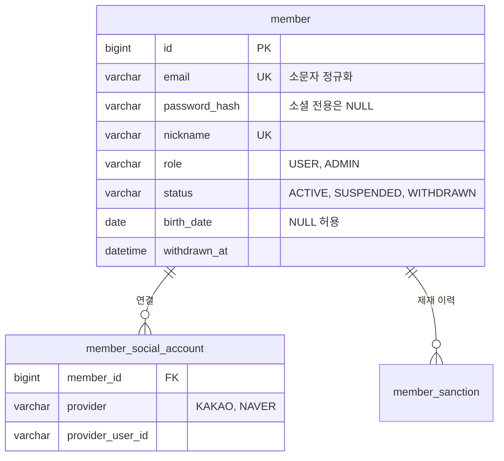

# 회원·인증

이메일 가입, Redis 세션 로그인, 카카오·네이버 소셜 로그인, 연령 확인용 생년월일, 관리자의 정지·권한 변경을 다룹니다.

## 주요 기능

| 기능 | 설명 |
|---|---|
| 가입 | 이메일·비밀번호·닉네임. 생년월일은 선택입니다 |
| 로그인·로그아웃 | JSON 본문으로 로그인하고 세션 쿠키(`SUMYSESSION`)를 받습니다. 세션은 Redis에 있습니다 |
| 소셜 로그인 | 카카오·네이버. Spring Security `oauth2Login`이 처리하고, 결과를 회원과 연결합니다 |
| 생년월일 등록 | 연령 등급이 있는 게임을 사려면 필요합니다. 한 번만 등록합니다 |
| 정지·해제·권한 변경 | 관리자 기능입니다. 바뀌면 그 회원의 세션을 모두 끊습니다([관리자](admin.md)) |

## 핵심 규칙

- **이메일은 소문자로 정규화합니다.** `Foo@x.com`과 `foo@x.com`이 다른 회원이 되지 않게 합니다.
- **비밀번호는 10자 이상, 영문 대문자·소문자·숫자·특수문자 중 3종류 이상입니다.** 72바이트를 넘으면 거절합니다. BCrypt가 뒷부분을 조용히 잘라 버리기 때문입니다.
- **닉네임은 2~30자, 한글·영문·숫자·밑줄만 쓰고 중복될 수 없습니다.** 리뷰 작성자로 노출되므로 사칭을 막습니다.
- **로그인 실패 이유를 구분해 알려주지 않습니다.** 없는 계정, 틀린 비밀번호, 소셜 전용 계정, 정지 계정 모두 같은 400 메시지입니다. 구분하면 가입된 이메일 목록을 만들 수 있습니다. 이유는 로그에만 남깁니다.
- **로그인하면 세션을 새로 만듭니다.** 세션 고정 공격을 막습니다.
- **소셜 전용 계정에는 비밀번호가 없습니다.** 폼 로그인 경로로는 들어올 수 없습니다.
- **카카오는 인증된 이메일만 기존 회원에 연결하거나 새로 가입시킵니다.** 카카오는 인증하지 않은 이메일도 돌려줍니다. 남의 이메일을 적은 카카오 계정이 기존 회원에 붙으면 계정 탈취가 됩니다.
- **소셜 가입 시 닉네임이 겹치면 뒤에 번호를 붙입니다.** 사용자가 닉네임을 고를 기회가 없으므로 가입을 실패시키지 않습니다.
- **공급자 토큰은 DB에 저장하지 않습니다.** 공급자가 준 사용자 식별자만 보관합니다.
- **생년월일은 한 번 등록하면 회원이 바꿀 수 없습니다.** 바꿀 수 있으면 연령 제한 게임을 사기 직전에 나이를 올렸다 되돌리는 것으로 제한이 무력화됩니다. 같은 날짜를 다시 보내면 200으로 그대로 성공합니다(PUT 재시도에 안전). 미래 날짜와 만 120세 초과는 400입니다.
- **생년월일이 없으면 연령 제한 게임을 살 수 없습니다.** 전체 이용가만 예외입니다. 주문이 막힐 때 ProblemDetail의 `type`으로 이유를 나눠 줍니다.

| `type` | 뜻 | 프론트 동작 |
|---|---|---|
| `urn:sumy:problem:birth-date-required` | 생년월일 미등록 | 등록 화면으로 안내 |
| `urn:sumy:problem:age-restricted` | 연령 미달 | 구매 불가 안내 |
| `urn:sumy:problem:birth-date-already-registered` | 이미 다른 날짜로 등록됨 | 고객센터 안내 |

- **정지와 권한 변경은 세션을 끊어야 효력이 있습니다.** 권한과 상태는 로그인할 때 세션에 복사됩니다. 그래서 Spring Session의 주체 이름 색인으로 그 회원의 세션을 모두 지웁니다. 매 요청마다 DB에서 상태를 다시 읽는 대신, 드물게 일어나는 정지·권한 변경 쪽에 비용을 몰았습니다.
- **폼 로그인과 소셜 로그인의 세션 주체는 같은 타입(`MemberPrincipal`)이고, 주체 이름은 회원 식별자입니다.** 그래서 정지 시 두 경로의 세션이 함께 끊깁니다.
- **관리자는 자기 자신의 관리자 권한을 해제할 수 없습니다.** 마지막 관리자가 스스로를 강등하면 DB를 직접 고쳐야 복구됩니다.

## 대표 API

| 메서드 | 경로 | 설명 |
|---|---|---|
| POST | `/api/members` | 가입. 201, 중복은 409 |
| PUT | `/api/members/me/birth-date` | 생년월일 등록 |
| POST | `/api/auth/login` | 로그인. 실패는 400(D19) |
| POST | `/api/auth/logout` | 로그아웃. 세션이 없어도 204 |
| GET | `/api/auth/me` | 현재 회원. 비로그인은 401 |
| GET | `/oauth2/authorization/{공급자}` | 소셜 로그인 시작(브라우저 이동). 게이트웨이 경유 |
| GET | `/login/oauth2/code/{공급자}` | 공급자 콜백. Spring Security가 처리 |

소셜 경로는 `oauth2` 프로파일이 켜지고 클라이언트 등록 정보가 있을 때만 활성화됩니다(D14). 키가 없어도 서비스는 뜹니다.

## 데이터 모델

- `member_social_account`는 `(provider, provider_user_id)`와 `(member_id, provider)` 두 유니크 제약이 있습니다. 한 회원이 카카오와 네이버를 함께 연결할 수 있습니다.
- 제재 이력(`member_sanction`)은 [리뷰·신고](review-report.md)에서 다룹니다.

## 레거시에서 무엇이 문제였고 어떻게 바꿨나

| 레거시 | 지금 |
|---|---|
| `/user/**` 인증 요구가 주석 처리되고 나머지 전부 `permitAll()` | 기본값을 닫힘으로 두고 공개 경로만 열거합니다 |
| 요청 본문의 `userId`만으로 비밀번호를 바꾸고 그 계정으로 로그인까지 시킴 | 회원 식별자는 항상 세션에서 가져옵니다. 본문이나 쿼리로 받지 않습니다 |
| 이메일 인증번호를 응답 본문으로 돌려줌 | 해당 흐름을 버렸습니다 |
| 카카오 가입자 전원에게 같은 고정 비밀번호를 부여 | 소셜 전용 계정은 비밀번호가 NULL이라 폼 로그인이 구조적으로 불가능합니다 |
| 블랙리스트 플래그가 인증에 반영되지 않음 | 정지 상태는 로그인을 막고, 열린 세션까지 끊습니다 |
| 이메일·닉네임 유니크 제약 없음 | 두 컬럼 모두 유니크 제약 |
| 주소·전화번호·성별·이름을 받고 어디에도 쓰지 않음 | 받지 않습니다. 생년월일만 NULL 허용으로 남겼습니다 |
| 소셜 키와 메일 비밀번호가 소스에 평문 | 모든 비밀값은 환경변수로 받습니다 |

!!! note "아직 API가 없는 것"
    닉네임·비밀번호 변경, 소셜 연결 해제, 탈퇴는 도메인 규칙과 테스트만 있고 API는 아직 없습니다. 탈퇴는 행을 지우지 않고 이메일·닉네임을 익명화해 같은 이메일로 다시 가입할 수 있게 설계했습니다.

## 테스트로 보장하는 것

- 도메인 테스트(`MemberTest` 33개, 값 객체 12개)가 비밀번호 정책, 생년월일 한 번 등록, 자기 강등 금지, 소셜 전용 계정의 폼 로그인 불가를 고정합니다.
- `SocialLoginIntegrationTest`는 WireMock 카카오로 실제 `oauth2Login` 전 구간을 돌려, 미인증 이메일 연결 거부와 소셜·폼 세션이 정지 시 함께 끊기는 것을 확인합니다.

## 관련 결정

| 번호 | 내용 |
|---|---|
| D14 | 소셜 로그인 설정은 `oauth2` 프로파일로 분리. 키가 없어도 기동 |
| D19 | 로그인 실패는 401이 아니라 400 |
| D32 | 생년월일은 자기 신고로 한 번만, 회원은 변경 불가 |
| D36 | 로컬 시드 회원은 운영에서 무력화 |
| D40 | 폼·소셜 주체를 하나로, 카카오는 인증된 이메일만 연결 |

## 관련 문서
- [기능 지도](index.md)
- [게이트웨이](gateway.md) (소셜 로그인 경로와 프록시 헤더)
- [관리자 기능](admin.md)
- [API 개요](../api.md)
