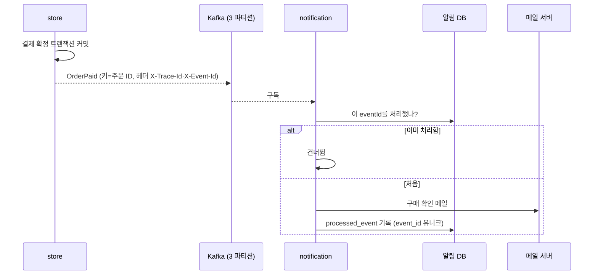
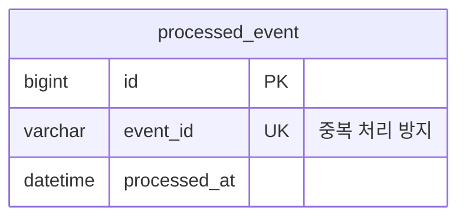

# 알림 서비스

store가 Kafka로 보낸 `OrderPaid` 이벤트를 받아 구매 확인 메일을 보내는 별도 서비스입니다. store와 DB를 공유하지 않고 이벤트로만 연결됩니다.

## 주요 기능

| 기능 | 설명 |
|---|---|
| 결제 완료 이벤트 소비 | 토픽 `sumy.order.paid.v1`, 컨슈머 그룹 `notification-order-paid` |
| 구매 확인 메일 | 주문 번호, 게임 제목 목록, 결제 금액을 담아 보냅니다 |
| 중복 처리 방지 | 처리한 이벤트 ID를 기록해 같은 이벤트를 두 번 처리하지 않습니다 |
| 요청 추적 | store가 메시지 헤더에 실은 `X-Trace-Id`를 이어받아 로그에 남깁니다 |

## 흐름

## 핵심 규칙

- **store는 커밋이 끝난 뒤에만 발행합니다.** `@TransactionalEventListener(AFTER_COMMIT)`으로 미룹니다. 커밋 전에 보내면 롤백된 결제가 메일로 나갑니다.
- **소비는 멱등입니다.** Kafka는 최소 한 번 전달하므로 같은 이벤트가 다시 올 수 있습니다. 이벤트 ID로 처리 이력을 확인하고, `processed_event.event_id` 유니크 제약을 마지막 방어선으로 둡니다. 고객에게 메일이 두 통 가는 것은 버그입니다.
- **와이어 포맷은 공용 모듈(`common-event`) 한 곳에서 정합니다.** 발행 쪽과 구독 쪽이 같은 `ObjectMapper` 설정을 씁니다. 시각은 ISO-8601 문자열이고, 모르는 필드는 무시합니다. 그래서 발행 쪽이 필드를 추가해도 구독 쪽을 먼저 배포하지 않아도 됩니다.
- **이벤트 계약은 추가만 허용합니다.** 필드 삭제나 의미 변경은 새 토픽(`.v2`)으로 합니다.
- **역직렬화 오류를 처리기로 감쌉니다(`ErrorHandlingDeserializer`).** 감싸지 않으면 읽을 수 없는 메시지 하나가 같은 오프셋에서 계속 재시도되며 뒤의 정상 메시지를 모두 막습니다.
- **파티션 수(3)를 발행 쪽과 구독 쪽이 똑같이 선언합니다.** 알림 서비스가 먼저 뜨면 브로커가 토픽을 1 파티션으로 자동 생성하고, 컨슈머가 늘어난 파티션을 한동안 받지 못하는 문제가 실제로 있었습니다.
- **메일 문구는 메시지 파일에 둡니다.** 로케일은 한국어로 고정했습니다(D16). 수신 주소는 개인정보라 로그에 남기지 않고 주문 ID로 추적합니다.
- **WebFlux + R2DBC로 짰습니다.** 이벤트 소비와 I/O뿐인 서비스라 블로킹 JDBC를 들이지 않습니다. Flyway는 R2DBC를 쓰지 못해 마이그레이션에만 JDBC URL을 따로 줍니다.
- **자체 스키마(`sumy_notification`)를 씁니다.** DB를 공유하면 스키마 변경이 두 서비스의 동시 배포를 강요합니다(D05).

!!! warning "알려진 한계"
    - 처리 순서가 "이력 확인 → 메일 발송 → 이력 기록"이라, 메일을 보낸 직후 기록 전에 서비스가 죽으면 다시 받았을 때 한 번 더 보낼 수 있습니다.
    - 발송이 실패하면 예외를 던져 Spring Kafka 기본 오류 처리기의 재시도에 맡깁니다. 별도 재시도 정책과 DLT 설정은 아직 없습니다.
    - store가 커밋 직후 직접 발행하므로, 커밋과 발행 사이에 store가 죽으면 이벤트를 잃을 수 있습니다. 아웃박스 테이블 + Debezium으로 바꾸는 것이 계획에 있습니다([로드맵](../../overview/roadmap.md)).
    - `MemberRegistered`, `ReviewReported` 이벤트도 발행하지만 아직 구독하는 쪽이 없습니다.

## 이벤트 계약

| 이벤트 | 토픽 | 주요 필드 | 구독 |
|---|---|---|---|
| `OrderPaid` | `sumy.order.paid.v1` | `eventId`, `occurredAt`, `orderId`, `memberId`, `email`, `totalAmount`, `gameTitles` | 알림 서비스 |
| `MemberRegistered` | `sumy.member.registered.v1` | `eventId`, `occurredAt`, `memberId`, `email`, `nickname` | 없음 |
| `ReviewReported` | `sumy.review.reported.v1` | `eventId`, `occurredAt`, `reviewId`, `reporterMemberId`, `reason` | 없음 |

외부에 여는 HTTP API는 없습니다. 헬스·메트릭용 Actuator만 엽니다.

## 데이터 모델

## 레거시에서 무엇이 문제였고 어떻게 바꿨나

| 레거시 | 지금 |
|---|---|
| 메일 HTML 문자열을 유틸 클래스 안에서 직접 이어 붙임 | 문구는 메시지 파일에서 |
| Gmail 앱 비밀번호와 발신 주소가 설정·코드에 평문 | 모든 메일 접속 정보는 환경변수 |
| 메일 발송 예외를 `printStackTrace()`로 삼키고 정상 흐름 계속 | 예외를 로그로 남기고 다시 던져 재처리 대상으로 |
| 메일 발송이 요청 처리와 같은 서비스·같은 흐름 | 별도 서비스가 이벤트로 받음. 알림이 죽어도 주문은 계속 받음 |

## 테스트로 보장하는 것

- `OrderPaidListenerIntegrationTest`(3개)는 실제 Kafka·MySQL(Testcontainers)에서 이벤트를 받아 메일이 나가는 것, 같은 이벤트를 두 번 보내도 메일이 한 통이고 이력이 한 줄인 것을 확인합니다.
- store 쪽 `OrderEventIntegrationTest`(4개)는 롤백된 트랜잭션의 이벤트가 발행되지 않는 것, 같은 결제를 두 번 확정해도 이벤트가 한 번인 것, 발행한 메시지가 알림 서비스가 읽을 수 있는 모양인 것을 확인합니다.

## 관련 결정

| 번호 | 내용 |
|---|---|
| D03 | 리액티브는 실제로 이득이 있는 곳(게이트웨이, 알림)에만 |
| D05 | 서비스 간 DB 공유 금지 |
| D09 | 구조화 로그와 `traceId` 전파를 먼저 깔아 둠 |
| D16 | 로케일 한국어 고정, 문구는 메시지 파일 |

## 관련 문서
- [트러블슈팅 1: 실제로 띄워 보니 메일이 한 통도 안 나갔다](../../troubleshooting/01-it-compiles-but.md)
- [아키텍처: 이벤트 흐름](../architecture.md)
- [주문·결제](order-payment.md)
