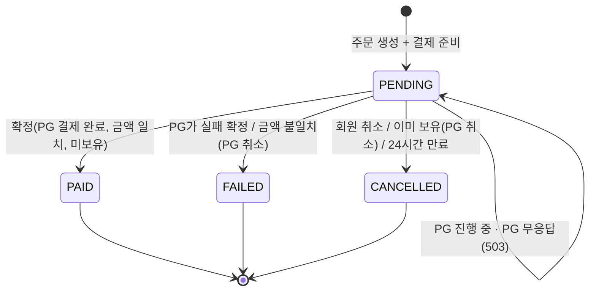
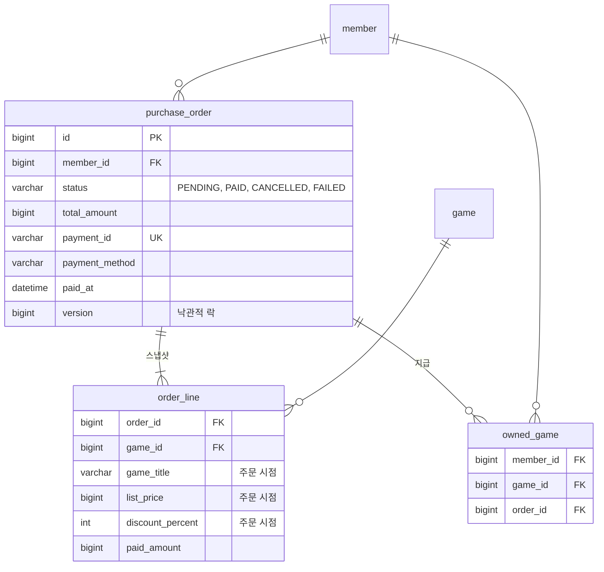

# 주문·결제

주문 생성부터 PortOne 결제 확정, 미결제 취소, 결제 웹훅, 미확정 주문 대사까지 다룹니다. 레거시에서 통째로 버리고 새로 설계한 영역입니다.

## 주요 기능

| 기능 | 설명 |
|---|---|
| 주문 생성 | 게임 식별자만 받습니다. 금액은 서버가 현재 카탈로그 가격으로 계산하고 PG 결제를 준비합니다 |
| 결제 확정 | PG에서 실결제액을 조회해 주문 금액과 비교한 뒤 확정합니다 |
| 미결제 주문 취소 | 결제 대기 주문만 취소합니다. PG에 준비된 결제가 있으면 함께 취소합니다 |
| 결제 웹훅 | 사용자가 결제 직후 브라우저를 닫아도 PG 알림으로 확정합니다 |
| 미확정 주문 대사 | 웹훅이 오지 않은 주문을 스케줄이 PG에 조회해 확정하거나 만료시킵니다 |
| 주문 내역 | 내 주문 목록(페이지)과 상세 |

## 주문 상태

- **`PENDING`에서만 전이합니다.** 결제된 주문의 취소는 409입니다. 환불은 별도 흐름으로 계획돼 있습니다(아직 구현 전).
- **PG가 "진행 중"이면 실패로 굳히지 않습니다.** 가상계좌처럼 늦게 들어오는 결제를 잃지 않기 위해서입니다.
- **PG가 응답하지 않으면 주문을 그대로 두고 503을 돌려줍니다.** 다시 요청하면 같은 판단을 다시 합니다.
- **이미 취소된 주문에 취소를 다시 보내면 200입니다(D34).** 더블 클릭과 재시도에 안전합니다.

## 핵심 규칙

- **클라이언트가 보낸 금액을 쓰지 않습니다.** 주문 총액은 주문 줄의 합으로만 계산하고, 확정 때는 PG가 알려준 실결제액과 비교합니다.
- **주문 줄은 주문 시점의 제목·정가·할인율·결제액을 스냅샷으로 갖습니다.** 나중에 게임 가격이 바뀌어도 영수증은 그대로입니다.
- **주문 생성 시 판매 중 여부, 보유 여부, 연령 등급을 확인합니다.** 막히면 409이고, `detail`에 어느 게임 때문인지 제목을 담습니다.
- **같은 게임을 한 주문에 두 번 담을 수 없고, 한 주문은 50개까지입니다.**
- **보유 여부를 확정 시점에 다시 확인합니다.** 대기 주문 두 개를 둘 다 결제하면 두 번째 확정에서 PG 결제를 전액 취소하고 주문을 닫습니다.
- **확정 요청의 결제 ID가 주문에 부여된 값과 다르면 PG를 부르기 전에 거절합니다.** 남의 결제를 조회하거나 취소하는 통로를 막습니다.
- **PG 호출은 트랜잭션 밖에서 합니다.** 짧은 읽기 트랜잭션 → PG 호출 → 짧은 쓰기 트랜잭션입니다. PG가 느려도 DB 커넥션을 붙잡지 않고, 실패 기록이 롤백되지 않습니다. 타임아웃은 연결 3초, 읽기 10초입니다.
- **확정과 취소는 같은 주문 단위 Redis 잠금을 잡습니다.** 잠금이 만료되거나 유실돼도 DB 낙관적 락(`@Version`)과 `owned_game` 유니크 제약이 마지막에 막습니다.
- **남의 주문은 404로 응답합니다.** 403이면 그 번호의 주문이 있다는 사실이 새어 나갑니다.
- **결제가 확정되면 같은 트랜잭션에서 라이브러리에 지급하고 위시리스트에서 뺍니다.** 커밋이 끝난 뒤에만 `OrderPaid` 이벤트를 발행합니다.

## 이중 결제 방지 요약

| 상황 | 주문 | 돈 | 응답 |
|---|---|---|---|
| PG 타임아웃·5xx | PENDING | 알 수 없음 | 503 (다시 시도) |
| PG 결제 진행 중 | PENDING | 아직 | 409 |
| PG 결제 실패 확정 | FAILED | 빠지지 않음 | 409 |
| 금액 불일치 | FAILED | PG 취소 | 409 |
| 다른 주문으로 이미 보유 | CANCELLED | PG 취소 | 409 |
| 취소된 주문에 결제가 들어옴 | CANCELLED | PG 취소 | 409 |
| 같은 확정 요청 반복 | 그대로 | 한 번만 | 현재 상태 |

문제를 어떻게 찾았고 테스트로 어떻게 재현했는지는 [트러블슈팅 2: 같은 게임을 두 번 결제하면 돈이 두 번 빠졌다](../../troubleshooting/02-double-payment.md)에 있습니다.

## 웹훅과 대사

- **웹훅 서명은 PortOne 공식 SDK로 검증합니다(Standard Webhooks, 5분 허용 오차).** 서명 검증을 직접 만들지 않았습니다(D24, D39).
- **웹훅 본문은 "다시 조회하라"는 신호로만 씁니다.** 본문에서 결제 ID만 꺼내 클라이언트 확정과 **같은 코드 경로**를 탑니다. 서명 비밀이 새도 결제를 위조할 수 없습니다.
- 응답 코드가 PG의 재전송을 정합니다. 판단이 끝났으면 200, PG가 응답하지 않아 결과를 모르면 503으로 다시 받습니다. 서명이 틀리면 401입니다.
- 운영(`prod`) 프로파일에서 웹훅 비밀이 없으면 기동하지 않습니다. 로컬은 비밀이 없으면 웹훅 경로가 404로 꺼집니다.
- **대사 스케줄은 1분마다 돕니다.** 주문한 지 10분이 지난 `PENDING`을 오래된 순으로 30건씩 PG에 조회합니다. 결제됐으면 확정하고, 24시간이 지났는데 결제가 없으면 취소합니다. 만료 전에 반드시 확정을 먼저 시도하므로 돈이 들어온 주문을 취소하지 않습니다.
- 여러 인스턴스 중 한 곳에서만 돌도록 ShedLock(JDBC, DB 시각 기준)을 겁니다.

## 대표 API

| 메서드 | 경로 | 설명 |
|---|---|---|
| POST | `/api/orders` | 주문 생성. 201, 결제 ID와 리다이렉트 주소 반환 |
| POST | `/api/orders/{orderId}/confirm` | 결제 확정 |
| POST | `/api/orders/{orderId}/cancel` | 미결제 주문 취소 |
| GET | `/api/orders` | 내 주문 목록. 공통 페이지 봉투, `size` 범위 밖은 400(D33) |
| GET | `/api/orders/{orderId}` | 주문 상세 |
| POST | `/api/payments/portone/webhook` | PG 웹훅. 서명으로 인증, OpenAPI 스펙에서 제외 |

## 데이터 모델

- `order`는 SQL 예약어라 테이블 이름을 `purchase_order`로 정했습니다.
- `owned_game (member_id, game_id)` 유니크 제약이 동시 확정의 마지막 방어선입니다.
- 매출 집계용 `(status, paid_at, ...)` 커버링 인덱스와 대사용 `(status, ordered_at)` 인덱스를 따로 두었습니다.

## 레거시에서 무엇이 문제였고 어떻게 바꿨나

| 레거시 | 지금 |
|---|---|
| 결제 승인(approve) 호출이 코드에 0건. 성공 콜백 URL만 부르면 결제 없이 구매 확정 | PG에서 실결제액을 조회해 비교한 뒤에만 확정 |
| 결제 금액을 화면 DOM 텍스트에서 읽어 그대로 PG에 전달 | 서버가 카탈로그 가격으로 계산 |
| 합계가 0 이하이면 PG를 건너뛰고 구매 확정 URL을 직접 호출 | 확정은 항상 PG 검증을 거침 |
| 구매 기록이 4컬럼뿐(금액·수단·거래 ID 없음), 주문 상태 없음 | 주문 애그리거트 + 상태 기계 + 결제 ID 기록 |
| 같은 게임을 몇 번이든 살 수 있음 | 생성·확정 두 시점 확인 + 유니크 제약 |
| 단건 결제가 게임 ID를 세션에 저장, 위시리스트 첫 항목을 엉뚱하게 삭제 | 주문이 줄을 갖고, 산 게임만 위시리스트에서 제거 |
| 컨트롤러가 `HttpURLConnection`으로 카카오페이를 직접 호출, 키 하드코딩 | `PaymentGatewayPort` 뒤 PortOne 어댑터, 키는 환경변수. 키가 없으면 Fake 어댑터(D07) |

## 테스트로 보장하는 것

- `OrderTest`(25개)와 `OrderServiceTest`(47개)가 상태 전이와 실패 경로별 주문·돈의 상태를 고정합니다.
- `PaymentConsistencyIntegrationTest`(11개)는 실제 MySQL·Redis와 WireMock PG로 순차·동시 이중 결제와 확정·취소 경합을 재현합니다. `PaymentWebhookIntegrationTest`(10개)는 서명 검증, 재전송 멱등, 스케줄만으로 확정되는 경로를 확인합니다.

## 관련 결정

| 번호 | 내용 |
|---|---|
| D07 | PG는 PortOne, 키가 없으면 Fake 어댑터 |
| D33 | 주문 목록은 공통 페이지 봉투, 범위 밖 크기는 400 |
| D34 | 미결제 취소는 `POST .../cancel`, 재요청은 200 |
| D38 | 이중 결제는 확정 시점 재확인 + PG 자동 취소, 잠금 + `@Version` |
| D39 | 웹훅은 공식 SDK로 서명 검증, 본문은 신호로만. 대사는 ShedLock 스케줄 |

## 관련 문서
- [트러블슈팅 2: 이중 결제](../../troubleshooting/02-double-payment.md)
- [라이브러리·위시리스트](library-wishlist.md)
- [알림 서비스](notification.md)
- [아키텍처: 이벤트 흐름](../architecture.md)
