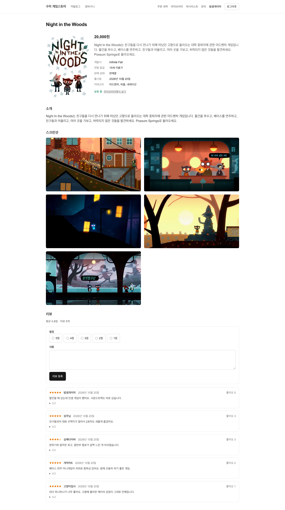
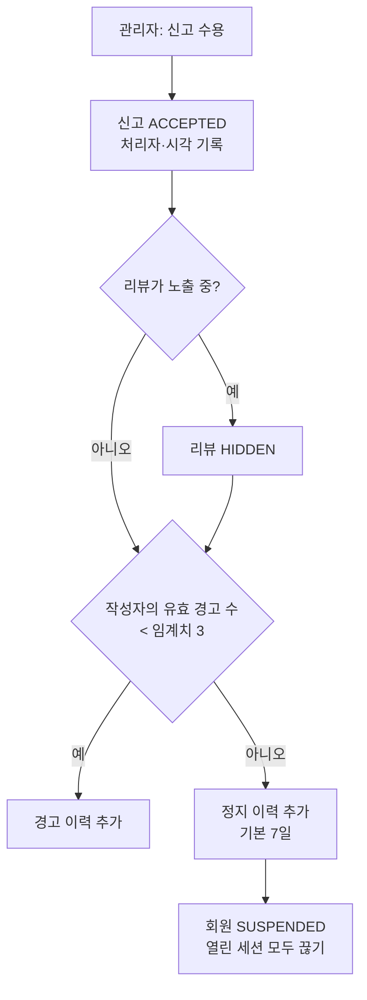
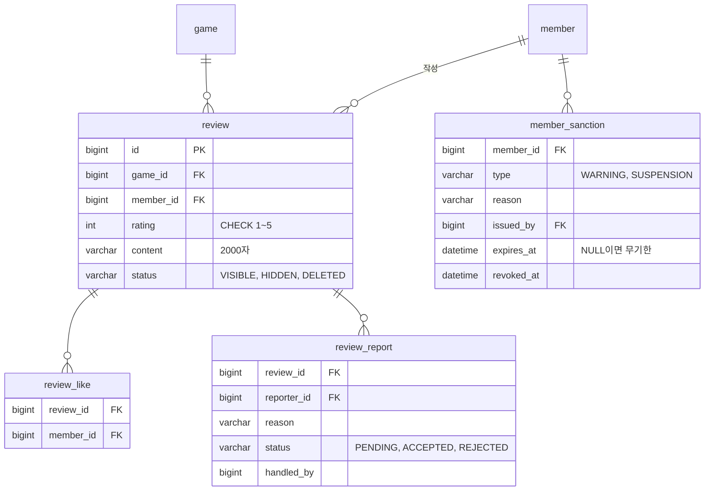
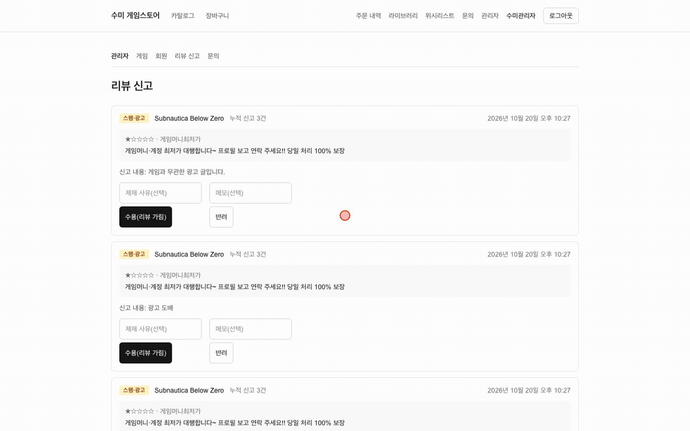

# 리뷰·좋아요·신고·제재

구매한 게임에 리뷰를 쓰고, 좋아요를 누르고, 문제 있는 리뷰를 신고합니다. 관리자가 신고를 받아들이면 리뷰를 가리고 작성자에게 경고나 정지를 줍니다.

## 주요 기능

| 기능 | 설명 |
|---|---|
| 리뷰 목록 | 로그인 없이 봅니다. 평균 별점과 전체 개수를 함께 내려줍니다 |
| 리뷰 작성·수정·삭제 | 작성은 구매한 게임에만, 수정·삭제는 본인 리뷰만 |
| 좋아요·취소 | 여러 번 눌러도 한 번만 반영됩니다 |
| 신고 | 사유 5종(스팸, 욕설, 스포일러, 무관한 내용, 기타)과 선택 설명 |
| 신고 처리 | 관리자가 수용·반려하고, 가린 리뷰를 복구합니다 |
| 제재 | 경고·정지를 이력으로 남깁니다. 철회할 수 있습니다 |

## 핵심 규칙

- **구매한 게임에만 리뷰를 쓸 수 있습니다.** 유스케이스가 보유 여부를 확인해 도메인 생성 함수에 넘기고, 도메인이 거절합니다. 도메인은 저장소를 모릅니다.
- **한 회원은 한 게임에 리뷰 하나만 씁니다.** 두 번째는 409이고, `(game_id, member_id)` 유니크 제약이 최종 방어선입니다.
- **별점은 1~5 정수이고 기본값이 없습니다.** 기본값이 있으면 "평가하지 않음"과 "1점"을 구분할 수 없습니다. 본문은 2,000자까지입니다.
- **삭제는 행을 지우지 않고 상태만 `DELETED`로 바꿉니다.** 신고 이력이 리뷰를 참조하기 때문입니다.
- **가려진(`HIDDEN`) 리뷰는 작성자에게만 보입니다.** 왜 안 보이는지 알아야 고칠 수 있습니다.
- **남의 리뷰를 수정·삭제하려 하면 404입니다.** 403이면 그 리뷰 번호가 있다는 사실이 새어 나갑니다.
- **자기 리뷰에는 좋아요를 누를 수 없고, 신고할 수도 없습니다.**
- **좋아요 수는 `review_like` 행을 센 값입니다.** 누를 때마다 행 수로 다시 맞춥니다. 행이 진실이고 카운터는 결과입니다.
- **같은 사람이 같은 리뷰를 두 번 신고할 수 없습니다(409).** 신고 수를 부풀리는 것을 막습니다.
- **평균 별점은 저장하지 않고 조회할 때 집계합니다.** 레거시는 평균을 따로 저장했다가 갱신을 놓쳐 실제와 어긋났습니다.

### 신고 수용과 제재

- **수용은 한 트랜잭션입니다.** 신고 상태 변경, 리뷰 가림, 제재 기록, 조건부 회원 정지가 함께 커밋되거나 함께 롤백됩니다. 레거시는 이 네 가지를 따로 커밋해 "리뷰는 가려졌는데 경고는 없는" 상태가 생겼습니다.
- **임계치(기본 3)와 정지 기간(기본 7일)은 설정값입니다.** 운영 기준이라 배포 없이 바꿀 수 있게 했습니다.
- **같은 리뷰에 신고가 여러 건이면 두 번째부터는 이미 가려져 있습니다.** 그래도 신고 처리는 성공하고, 경고는 신고 건마다 쌓입니다.
- **반려는 리뷰와 작성자를 건드리지 않습니다.** 이미 처리된 신고를 다시 처리하면 409입니다.
- 관리자 대기 목록은 리뷰 본문, 게임 제목, 작성자 닉네임, 그 리뷰의 누적 신고 수를 한 번에 내려줍니다. 같은 리뷰에 신고가 몰리므로 리뷰·게임·작성자는 중복을 걷어낸 뒤 한 번씩만 읽습니다.

!!! note "아직 없는 것"
    정지 이력에는 만료 시각이 기록되지만, 만료되면 회원 상태를 자동으로 되돌리는 작업은 아직 없습니다. 지금은 관리자가 해제합니다. 신고 접수 시 `ReviewReported` 이벤트를 발행하지만 구독하는 서비스는 아직 없습니다.

## 대표 API

| 메서드 | 경로 | 설명 |
|---|---|---|
| GET | `/api/games/{gameId}/reviews` | 리뷰 목록 + 평균 별점. 비로그인 가능 |
| POST | `/api/games/{gameId}/reviews` | 작성. 미구매·중복은 409 |
| PUT | `/api/reviews/{reviewId}` | 내 리뷰 수정 |
| DELETE | `/api/reviews/{reviewId}` | 내 리뷰 삭제(상태 변경). 204 |
| PUT / DELETE | `/api/reviews/{reviewId}/like` | 좋아요 / 취소. 현재 좋아요 수 반환 |
| POST | `/api/reviews/{reviewId}/reports` | 신고. 204 |
| GET | `/api/admin/reviews/reports` | 처리 대기 신고 목록(관리자) |
| POST | `/api/admin/reviews/reports/{reportId}/accept` | 수용(관리자) |
| POST | `/api/admin/reviews/reports/{reportId}/reject` | 반려(관리자) |
| POST | `/api/admin/reviews/{reviewId}/restore` | 가린 리뷰 복구(관리자) |

## 데이터 모델

유니크 제약: `review (game_id, member_id)`, `review_like (review_id, member_id)`, `review_report (review_id, reporter_id)`.

## 레거시에서 무엇이 문제였고 어떻게 바꿨나

| 레거시 | 지금 |
|---|---|
| 별점을 문자열 `enum('1'..'5')`로 저장하고 기본값이 1점, SQL에서는 숫자처럼 평균 | `INT` + CHECK, 값 객체 `Rating`, 기본값 없음 |
| 구매 여부 확인 없음, 리뷰 작성자 `userId`를 요청 본문에서 받음 | 구매자만 작성, 작성자는 세션에서 |
| 한 사람이 한 게임에 리뷰를 무제한 작성 | 유니크 제약 + 유스케이스 확인 |
| 리뷰 수정·삭제에 소유자 확인 없음 | 본인만, 남의 것은 404 |
| 좋아요 카운터만 있어 누가 눌렀는지 모르고 중복을 못 막음 | `review_like` 행이 진실 |
| 신고 카운터를 두 테이블에 이중 저장해 불일치 | `review_report` 행만 진실, 수는 셈 |
| 경고 횟수(int) + 블랙리스트(tinyint)로는 "왜, 언제까지"를 답하지 못하고 되돌릴 수 없음 | `member_sanction` 이력, 철회 가능 |
| 신고 등록이 쓰기 3번을 트랜잭션 없이 수행, 리뷰 가림과 경고를 따로 커밋 | 신고 접수와 수용 처리가 각각 한 트랜잭션 |

## 테스트로 보장하는 것

- `ReviewTest`(24개)가 구매자만 작성, 가린 리뷰는 작성자에게만 노출, 삭제는 상태 변경, 자기 리뷰 신고 불가, 정지 만료·철회 판단을 고정합니다.
- 스모크가 실제 앱에서 신고 → 대기 목록 → 수용(리뷰 가림) → 복구까지 확인합니다.

## 관련 결정

| 번호 | 내용 |
|---|---|
| D06 | 평균 별점 같은 집계는 JDSL로 그때그때 계산 |
| D18 | 좋아요 수 응답도 이름 있는 DTO(`ReviewLikeCountResponse`) |
| D40 | 정지 시 폼·소셜 세션을 함께 끊기 위해 세션 주체 이름을 회원 식별자로 통일 |

## 관련 문서
- [기능 지도](index.md)
- [회원·인증](member.md) (정지와 세션 회수)
- [관리자 기능](admin.md)
