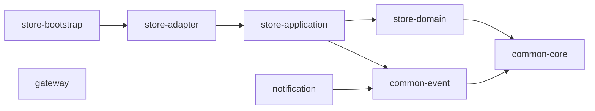

# 모듈 구조

백엔드 저장소는 Gradle 멀티 모듈 8개로 나뉩니다. store 안의 의존 방향은 문서가 아니라 모듈 경계와 아키텍처 테스트가 강제합니다.

## Gradle 모듈

| 모듈 | 역할 | 의존하는 프로젝트 모듈 |
|---|---|---|
| `common:common-core` | 공통 오류 타입(`InvalidRequest`, `NotFound`, `IllegalStateTransition`, `ExternalServiceUnavailable`) | 없음 |
| `common:common-event` | 서비스 간 이벤트 계약, 토픽 이름, Kafka 와이어 포맷 | common-core |
| `services:store:store-domain` | 엔티티·값 객체·도메인 규칙. 순수 Kotlin | common-core |
| `services:store:store-application` | 유스케이스, 포트(인터페이스) 선언 | store-domain, common-event |
| `services:store:store-adapter` | 웹·영속성·결제·스토리지·이벤트·보안 어댑터 | store-application |
| `services:store:store-bootstrap` | 실행 모듈. 설정 파일, 통합 테스트, 아키텍처 테스트 | store-adapter |
| `services:gateway` | Spring Cloud Gateway | 없음 |
| `services:notification` | Kafka 소비, 메일 | common-event |



## 의존 규칙

- **store-domain은 프레임워크 의존이 0입니다.** 빌드 파일에 common-core 하나만 있습니다. 스프링·JPA·Jackson·Kafka·AWS를 쓸 수 없습니다. JPA 엔티티는 영속성 어댑터에 따로 두고 매퍼로 변환합니다.
- **store-application은 포트만 선언하고 기술을 모릅니다.** 허용한 예외는 트랜잭션 경계용 `spring-tx`와 빈 등록용 `spring-context`뿐입니다.
- **어댑터만 기술을 압니다.** Spring MVC, Security, OAuth2 Client, Spring Session, JPA, Kotlin JDSL, AWS S3, PortOne SDK, Kafka, ShedLock은 모두 store-adapter에만 있습니다.
- **어댑터끼리 서로를 참조하지 않습니다.** 결제 어댑터가 영속성 어댑터를 부르지 않고 포트를 거칩니다.
- **서비스끼리는 코드로 의존하지 않습니다.** notification은 store를 모르고 `common-event`의 계약만 압니다. gateway는 다른 모듈에 의존하지 않습니다.
- **리액티브 경계를 섞지 않습니다.** store에는 WebFlux를, notification에는 JPA를 넣지 않습니다(D03).

처음에는 어댑터마다 Gradle 모듈을 두어 store가 8개 모듈이었는데, 지금의 4개로 합쳤습니다. 의존 방향은 이미 안쪽 모듈 경계와 아키텍처 테스트가 강제하는데, 같은 규칙을 두 번 강제하면서 빌드 설정만 늘었기 때문입니다(D12). 대신 어댑터끼리의 침범은 컴파일러가 막지 못하므로 아키텍처 테스트가 맡습니다.

## 패키지 구조 예시

```text
com.sumy.gamestore.store
├── domain                      (store-domain)
│   ├── catalog                 Game, Category, GameImage, Money, AgeRating
│   ├── member                  Member, Email, Nickname, RawPassword, PasswordHash
│   ├── order                   Order, OrderLine
│   ├── review                  Review, ReviewReport, MemberSanction
│   ├── support                 Inquiry, News
│   └── wishlist                Wishlist
├── application                 (store-application)
│   ├── port
│   │   ├── inbound             *UseCase 인터페이스 (16개)
│   │   └── outbound            *Port 인터페이스 (20개 파일)
│   └── usecase                 *Service 구현 (17개)
└── adapter                     (store-adapter)
    ├── inbound
    │   ├── web                 *Controller, ApiExceptionHandler
    │   │   ├── config          SecurityConfig, OpenApiConfig, TraceIdFilter ...
    │   │   └── dto             *Request, *Response, PageResponse
    │   └── scheduler           결제 대사 스케줄(ShedLock)
    └── outbound
        ├── persistence         *JpaEntity, *JpaRepository, *PersistenceAdapter, *JdslAdapter
        ├── payment             PortOnePaymentAdapter, FakePaymentAdapter
        ├── storage             S3FileStorageAdapter
        ├── event               KafkaEventPublisherAdapter
        ├── security            MemberPrincipal, 소셜 로그인, BCrypt, 세션 회수
        └── system              시계, ID 생성, Redis 멱등 잠금, 운영 정책 설정
```

## 아키텍처 테스트가 검사하는 규칙

`HexagonalArchitectureTest`(Konsist)가 7가지 규칙을 검사합니다. 하나라도 어기면 테스트가 실패하고 CI가 막습니다.

| # | 규칙 | 검사 방법 |
|---|---|---|
| 1 | 도메인은 프레임워크에 의존하지 않는다 | store-domain 파일의 import에 `org.springframework`, `jakarta.persistence`, `jakarta.servlet`, `jakarta.validation`, Jackson(2·3), Swagger, Kafka, AWS SDK, Kotlin JDSL이 없어야 한다 |
| 2 | 애플리케이션은 웹·영속성·외부 연동 기술에 의존하지 않는다 | store-application의 import에 JPA, 서블릿, Swagger, `org.springframework.web`, Spring Data JPA, Kafka, AWS SDK, Kotlin JDSL이 없어야 한다 |
| 3 | 도메인과 애플리케이션은 어댑터를 참조하지 않는다 | 두 모듈의 import에 `.adapter.` 패키지가 없어야 한다 |
| 4 | 어댑터는 다른 어댑터를 참조하지 않는다 | 어댑터 슬라이스(`inbound/web`, `inbound/scheduler`, `outbound/persistence`, `storage`, `payment`, `event`)마다 다른 슬라이스 import 금지 |
| 5 | 포트는 정해진 패키지에만 선언한다 | 이름이 `*Port`, `*UseCase`인 인터페이스는 `application.port.outbound` 또는 `.inbound`에만 |
| 6 | 유스케이스 구현은 `usecase` 패키지에 둔다 | store-application의 `*Service` 클래스는 `application.usecase`에만 |
| 7 | JPA 엔티티는 영속성 어댑터 밖으로 나가지 않는다 | `adapter/outbound/persistence` 밖의 어떤 파일도 `*JpaEntity`를 import하지 않는다 |

!!! tip "규칙이 정말 잡는지 확인했습니다"
    4번 규칙은 처음에 파일 경로(슬래시)와 import(점)를 섞어 비교해, 아무것도 잡지 못하고 조용히 통과하고 있었습니다. 위반을 일부러 심어 테스트가 실패하는 것을 확인한 뒤에야 믿기로 했습니다. 새 어댑터 슬라이스를 만들면 테스트의 목록에도 등록해야 검사 대상이 됩니다. 지금 `outbound/security`와 `outbound/system`은 목록에 없어 이 규칙의 검사 대상이 아닙니다.

## 다음 구조(계획)

store를 member / catalog / order / payment / review / support 서비스로 나누고, 서비스마다 `<svc>-core`(domain + application), `<svc>-infra`(영속성·외부 클라이언트·메시지), `<svc>-api`·`<svc>-admin-api`(실행) 모듈을 두는 계획입니다. 서비스 안의 업무 경계는 Spring Modulith로 검사합니다(D21). 아직 구현 전이며 [로드맵](../overview/roadmap.md)에 있습니다.

## 관련 문서
- [아키텍처](architecture.md)
- [데이터 모델](data-model.md)
- [API 개요](api.md)
- [주요 기술 결정](../engineering/tech-decisions.md)
