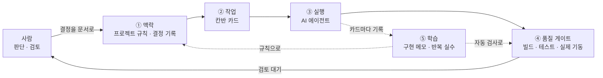

# AI 협업 방식

이 프로젝트는 AI 코딩 에이전트와 함께 개발합니다. AI가 빠르게 코드를 쓰는 것보다, **AI가 틀려도 결과가 망가지지 않는 구조**를 만드는 데 더 공을 들였습니다.

## 구조

| 층 | 역할 |
|---|---|
| ① 맥락 | 세션이 바뀌어도 같은 규칙으로 시작합니다. 프로젝트 규칙, 코드 컨벤션, 결정 기록(40건)을 먼저 읽게 합니다. 이미 내린 결정은 다시 논의하지 않습니다 |
| ② 작업 | 폴더가 곧 상태인 칸반입니다(할 일 → 진행 중 → 검토 → 완료). **카드 한 장이 커밋 하나**이고, 카드마다 범위(포함·제외)와 완료 조건이 있습니다 |
| ③ 실행 | 에이전트가 카드 한 장을 시작부터 커밋·푸시·CI 확인까지 처리합니다 |
| ④ 품질 게이트 | AI가 틀려도 기계가 막습니다. 포맷, 테스트, 아키텍처 규칙, 실제 기동, 스펙 검사 중 하나라도 실패하면 커밋할 수 없습니다 |
| ⑤ 학습 | 카드마다 구현 메모(무엇을, 왜, 무엇을 확인했나)를 남깁니다. 같은 실수가 두 번 나오면 규칙이나 자동 검사로 바꿉니다 |

## 사람과 AI의 몫

| 사람 | AI |
|---|---|
| 요구사항 해석, 범위, 우선순위 | 선택지와 추천 정리, 결정을 기록 |
| 되돌리기 비싼 결정, 외부 계정·비용 | 구현, 테스트, 문서, 검증 |
| 최종 검토 | 구현 메모와 확인할 점 정리 |

## 백엔드와 프론트엔드를 동시에
- 저장소가 달라 파일 충돌이 없으므로, 백엔드와 프론트엔드 에이전트를 함께 돌립니다.
- 순서는 하나만 지킵니다. **백엔드가 API를 끝내고 스펙을 내보낸 뒤에** 프론트엔드가 그 화면을 시작합니다. 목 데이터로 화면을 먼저 만들지 않습니다.
- 백엔드 카드마다 "프론트 영향"(없음 / 새 화면 / 연동 변경)을 적어 두어, 어느 카드를 병렬로 돌릴 수 있는지 바로 보입니다.

## 실제로 효과가 있었던 것
- **실제 기동 게이트**가 AI가 놓친 문제를 가장 많이 잡았습니다. 컴파일은 되는데 뜨지 않는 문제가 대표적입니다.
- **결정 기록**이 있어서 세션이 바뀌어도 같은 논의를 반복하지 않습니다. "결정 / 근거 / 되돌리는 방법" 형식이라, 나중에 바꿀 때도 무엇을 건드려야 하는지 바로 압니다.
- **에이전트의 보고를 그대로 믿지 않습니다.** 동시성 처리에 쓴 잠금이 여러 인스턴스에서도 안전한지, 가끔 실패한 CI가 우연인지 같은 핵심 주장은 직접 확인했습니다. 그 과정에서 [가끔 실패하는 테스트](../troubleshooting/03-flaky-rate-limit-test.md)의 원인을 찾았습니다.
