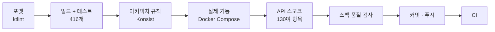

# 품질을 지키는 방법

원칙은 하나입니다. **사람이 기억해서 지키는 규칙은 결국 깨지므로, 기계가 막게 한다.**

## 검증 단계

커밋 전에 스크립트 하나(`verify.sh --smoke`)가 위 단계를 모두 돌립니다. **하나라도 실패하면 커밋하지 않습니다.**

## 테스트 구성

| 종류 | 무엇을 보나 | 도구 |
|---|---|---|
| 도메인 단위 테스트 | 상태 전이, 불변식(예: 결제 대기 주문만 결제 가능) | JUnit 5, kotest-assertions |
| 유스케이스 테스트 | 포트를 가짜로 바꿔 흐름 검증 | MockK |
| 외부 연동 테스트 | PG 응답 파싱, 오류 분류, 타임아웃 | WireMock |
| 통합 테스트 | 실제 MySQL·Redis·Kafka에 붙여 전체 컨텍스트로 | Testcontainers |
| 동시성 테스트 | 동시 결제 확정, 확정과 취소 경합 | 실제 DB + 스레드 |
| 아키텍처 테스트 | 모듈 의존 방향, 이름 규칙, 어댑터 간 참조 금지 | Konsist |
| API 스모크 | 실제로 띄운 서비스에 HTTP 호출 | 셸 스크립트 |
| E2E | 브라우저로 프론트와 백엔드를 함께 | Playwright (20개 시나리오) |

H2 같은 대체 DB와 `Thread.sleep`은 쓰지 않습니다. 실제와 다른 환경에서 통과한 테스트는 믿기 어렵기 때문입니다.

## 실제 기동 스모크
컴파일과 단위 테스트를 통과해도 기동하지 않는 문제가 실제로 있었습니다([트러블슈팅 1](../troubleshooting/01-it-compiles-but.md)). 그래서 커밋마다 전체를 띄워 확인합니다.

- 가입, 로그인, 장바구니, 주문, 결제 확정, 라이브러리까지 실제 흐름
- 이중 결제 자동 취소, 미결제 주문 취소, 결제 웹훅(서명 위조 거부, 중복 처리)
- OpenAPI 스펙에서 관리자 엔드포인트 **31개 전체**를 찾아, 비로그인은 401, 일반 회원은 403 인지 검사합니다. 새 관리자 API를 추가하면 자동으로 검사 대상이 됩니다.
- 게이트웨이를 거친 소셜 로그인 경로와 레이트리밋 키

## 스펙 품질 검사
프론트엔드가 스펙에서 타입을 생성하므로, 스펙이 곧 계약입니다. 스크립트로 다음을 확인합니다.
- 모든 오류 응답이 ProblemDetail 형식인지
- 선택 응답 필드에 nullable 표시가 있는지
- 자유형 맵(`Record<string, object>`)이 없는지

## 배포 설정 검증
- Helm 차트: lint → 실제 값으로 렌더링 → 쿠버네티스 스키마 검증(kubeconform)
- 필수 값이 비어 있으면 렌더링이 실패하는지, `latest` 태그가 거부되는지도 확인합니다.

## 가끔 실패하는 테스트를 넘기지 않는다
CI에서 한 번 실패하고 재실행에서 통과한 테스트도 원인을 찾아 고칩니다([트러블슈팅 3](../troubleshooting/03-flaky-rate-limit-test.md)).
