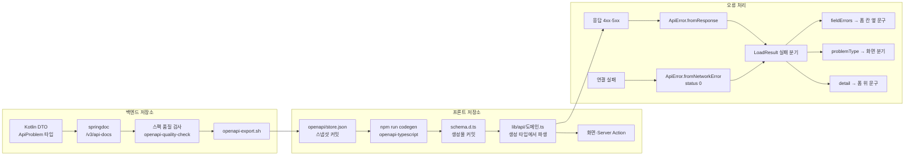
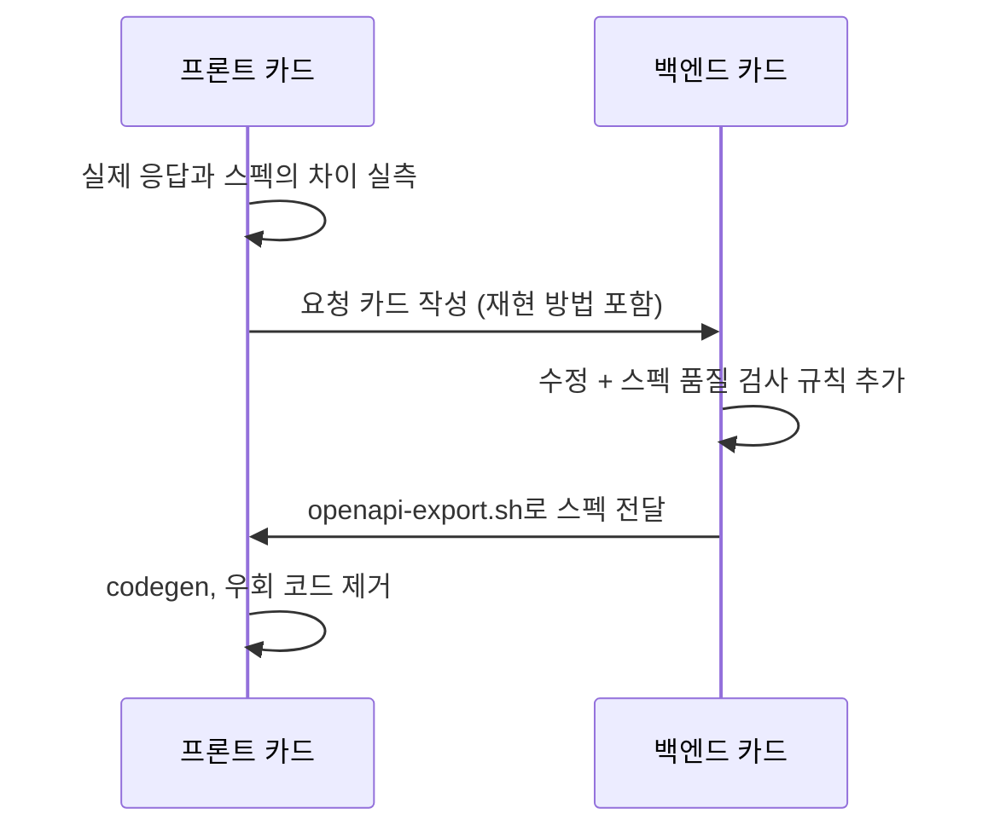

# API 계약과 타입 생성

프론트엔드와 백엔드는 OpenAPI 스펙 하나로 연결됩니다. 백엔드 스펙에서 TypeScript 타입을 생성하고, 오류는 RFC 9457 ProblemDetail 한 가지 모양으로 받습니다. 스펙과 실제 응답이 어긋난 곳을 찾으면 프론트에서 감추지 않고 백엔드를 고쳤습니다.

## 흐름



현재 스펙(직접 셈): 경로 51개, 연산 63개, 스키마 60개입니다.

## 타입 생성

| 단계 | 명령 | 하는 일 |
|---|---|---|
| 스펙 내보내기 | 백엔드 `./scripts/openapi-export.sh` | 스토어를 띄워 스펙을 받아 프론트 `openapi/store.json`에 씁니다 |
| 스펙 받아 재생성 | 프론트 `npm run codegen:fetch` | 로컬 백엔드에서 스펙을 받은 뒤 타입을 다시 만듭니다 |
| 재생성만 | 프론트 `npm run codegen` | 커밋된 스펙으로 `src/lib/api/schema.d.ts`를 만듭니다 |

**스펙과 생성물을 모두 커밋합니다.** CI에는 백엔드가 없습니다. 빌드 때 스펙을 받게 하면 프론트 CI가 백엔드에 묶입니다. 스냅샷을 커밋해 두면 프론트 저장소만으로 빌드되고, 스펙이 바뀐 내용이 diff로 보입니다.

**클라이언트 함수는 생성하지 않고 타입만 생성합니다.** 오류를 `ApiError`와 `LoadResult`로 다루는 규칙을 생성기가 알지 못하기 때문입니다. 도메인 파일은 생성 타입을 감싸지 않고 그대로 씁니다.

```ts
export type ProblemDetail = components['schemas']['ProblemDetail'];
export type FieldViolation = components['schemas']['FieldViolation'];
```

!!! tip "우회는 원인이 고쳐지면 바로 걷어낸다"
    초기 스펙에는 `required`가 없어 생성 타입이 전부 선택 필드였습니다. 한때 `Required<>`로 감싸 버텼지만, 백엔드가 코틀린 null 정보를 스펙에 연결한 뒤 바로 지웠습니다. 우회를 남겨 두면 다음 사람이 그게 필요한 줄 압니다. 스펙이 다시 느슨해지면 프론트에서 감싸지 않고 백엔드를 고칩니다.

## 오류 처리

백엔드는 모든 오류를 ProblemDetail로 냅니다. 프론트는 이것을 `ApiError` 한 곳에서 해석합니다.

| 필드·판정 | 쓰는 곳 |
|---|---|
| `status` 0 | 백엔드에 연결하지 못함. 예외로 올리지 않고 "잠시 후 다시" 안내로 분기합니다 |
| `status` 401 | 오류가 아니라 비로그인으로 다룹니다 |
| `status` 409 | 상태 충돌(이미 보유, 이미 결제됨 등). 재시도해도 결과가 같으니 이유를 보여 줍니다 |
| `errors[]` (`field`, `message`) | 400 검증 실패. 해당 입력 칸 옆에 문구를 붙입니다 |
| `type` (`urn:sumy:problem:<code>`) | 같은 상태 코드 안에서 화면 분기가 필요할 때만 붙습니다 |
| `detail` | 사용자에게 보여 줄 문구입니다. **분기에는 쓰지 않습니다** |
| `X-Trace-Id` 헤더 | 문의할 때 서버 로그를 찾는 추적 ID입니다 |

문구(`detail`)로 분기하지 않는 이유는 백엔드가 문구를 다듬는 순간 화면이 조용히 깨지기 때문입니다. `type`은 백엔드가 "클라이언트가 분기해야 하는 오류"에만 붙이는 계약입니다.

!!! note "스펙을 그대로 믿지 않는 곳"
    401·403은 Spring Security가 먼저 응답해 본문이 비어 있거나 기본 형식일 수 있습니다. 게이트웨이 타임아웃처럼 JSON이 아닌 응답도 있습니다. 그래서 `fromResponse`는 필수 필드(`title`, `status`)를 응답 상태 코드로 채워 둡니다. 외부 경계에서만 하는 처리입니다.

## 백엔드와 계약을 맞춘 사례

프론트에서 실측한 문제를 백엔드 카드로 올려 고치고, 스펙을 다시 받아 프론트의 우회 코드를 지우는 순서로 고쳤습니다.



### 1. 응답이 자유형 맵이라 키 오타를 못 잡음 (백엔드 T19)

| 항목 | 내용 |
|---|---|
| 증상 | 보유 여부·위시리스트 여부 응답이 `Map<String, Boolean>`이었습니다. 생성 타입이 인덱스 시그니처라 `data.owned`를 `data.owend`로 써도 컴파일이 통과했습니다 |
| 증상 2 | 로그인 400, 내 정보 401의 오류 스키마가 스펙에는 성공 응답 타입으로 적혀 있었습니다. `@ApiResponse`에 `content`를 주지 않으면 springdoc이 성공 스키마를 복사하기 때문입니다 |
| 백엔드 조치 | 전용 응답 DTO(`OwnershipResponse`, `WishlistStatusResponse`)로 바꾸고, 공통 오류 응답을 설정 한 곳에서 주입했습니다. 오류 응답이 모두 ProblemDetail인지 검사하는 스크립트를 스모크에 넣었습니다 |
| 결정 | 로그인 실패는 401로 바꾸지 않고 400으로 유지했습니다(백엔드 D19). 응답에 자유형 맵을 쓰지 않는다는 규칙을 남겼습니다(백엔드 D18) |
| 프론트 조치 | 생성 타입을 감싸던 `Required<>` 우회를 지웠습니다(프론트 D08) |

### 2. 생년월일 미등록과 연령 미달이 같은 409 (백엔드 T20)

앱으로 가입한 회원은 생년월일을 넣을 곳이 없어서 연령 등급 게임을 살 수 없었습니다. 주문 409도 두 경우가 같은 문구라 프론트가 등록 화면으로 보낼지 정할 수 없었습니다.

- 백엔드는 생년월일 등록 API를 열고, 409에 `type`을 붙여 `birth-date-required`와 `age-restricted`를 나눴습니다. 생년월일은 자기 신고로 한 번만 등록하고 회원이 바꿀 수 없게 했습니다(백엔드 D32).
- 프론트는 `birth-date-required`일 때만 `/account?next=/cart` 링크를 붙이고, 등록이 끝나면 장바구니로 돌려보냅니다. 연령 미달은 등록해도 풀리지 않으므로 링크 없이 문구만 보입니다(프론트 T11, D21).

### 3. 주문 목록이 맨 배열 (백엔드 T21)

주문 목록만 배열로 내려와 전체 개수를 몰라 번호 페이징을 할 수 없었습니다. 백엔드가 다른 목록과 같은 페이지 봉투로 바꾸고, 범위 밖 페이지 크기는 조용히 깎지 않고 400으로 거절하게 했습니다(백엔드 D33). "이미 보유" 409 문구에는 어느 게임인지 제목을 담았습니다. 프론트는 이 봉투로 주문 목록 페이징을 만들었습니다(프론트 T12).

### 4. nullable 표시 누락으로 1970년 날짜 (백엔드 T23, 프론트 T13)

결제 전 주문의 결제 시각 칸에 1970년 1월 1일이 찍혔습니다. 응답은 `null`인데 스펙에는 "선택 필드"로만 적혀 있어 생성 타입이 `paidAt?: string`이 됐기 때문입니다.

| 쪽 | 조치 |
|---|---|
| 백엔드 | 직접 등록했던 스키마 처리기 빈을 지워 springdoc 내장 코틀린 nullable 처리가 돌게 했습니다. null 표시 35곳이 생겼고, 늘 값이 있는 응답 `id` 7곳은 필수로 바꿨습니다. ProblemDetail 스키마를 실제 응답에 쓰는 코틀린 타입에서 생성하게 했습니다(백엔드 D35) |
| 백엔드 검사 | "선택 응답 필드는 nullable", "ProblemDetail은 정해진 모양" 규칙을 품질 검사에 추가했습니다 |
| 프론트 | 손으로 쓴 `ProblemDetail`·검증 오류 타입을 생성 타입으로 바꾸고, "스펙은 optional이지만 실제는 null" 주석과 `?? undefined` 우회를 모두 지웠습니다. nullable 값의 분기는 이제 타입이 요구하는 정상 분기입니다 |

자세한 과정은 [트러블슈팅 4](../troubleshooting/04-spec-vs-response.md)에 있습니다.

!!! note "남은 차이"
    백엔드는 닉네임·비밀번호 같은 **도메인 규칙** 위반을 `errors[]` 없이 `detail` 한 줄로 줍니다. 그래서 이 경우는 칸 옆이 아니라 폼 위에 문구가 보입니다. 칸별 표시는 빈 값·미래 날짜 같은 형식 검증에만 됩니다. E2E에서 확인한 현재 동작입니다.

## 관련 문서

- [프론트엔드 개요](index.md)
- [데이터 가져오기·캐시·인증](data-fetching.md)
- [E2E 테스트](e2e.md)
- [품질을 지키는 방법](../engineering/quality.md)
- [트러블슈팅 4: API 스펙과 실제 응답의 차이](../troubleshooting/04-spec-vs-response.md)
