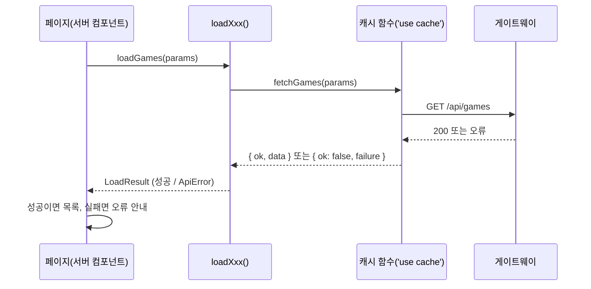
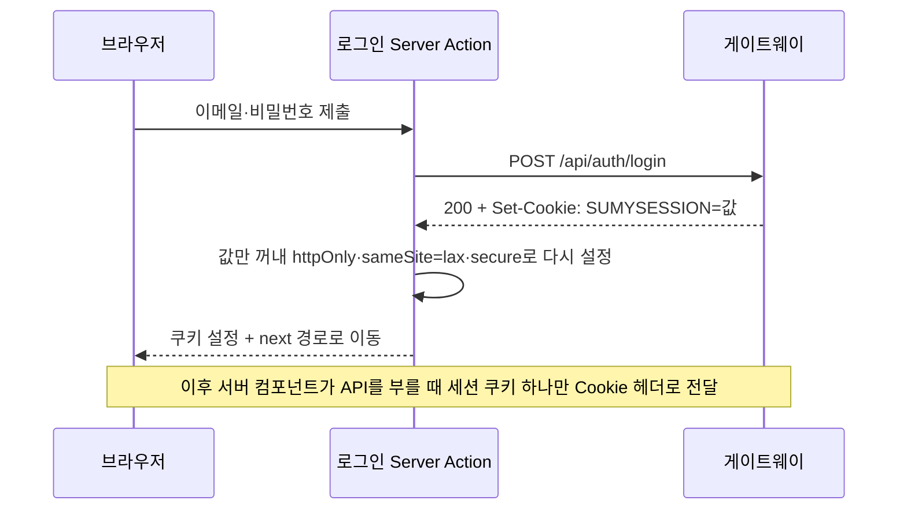
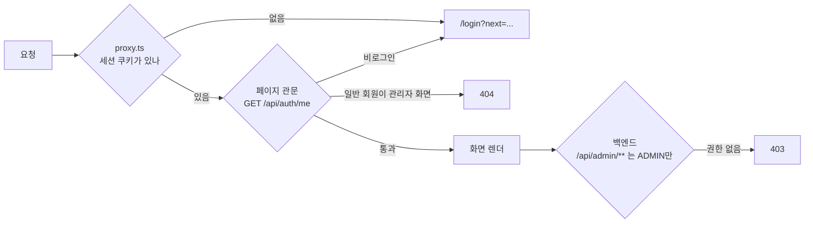

# 데이터 가져오기·캐시·인증

데이터는 서버 컴포넌트가 읽고, 변경은 Server Actions가 합니다. 모두가 같은 내용을 보는 데이터만 캐시하고, 사용자별 데이터는 캐시하지 않습니다. 로그인 확인은 여러 겹으로 하되, 차단의 근거는 항상 서버 쪽에 둡니다.

## 한눈에 보기

| 구분 | 방식 | 예 |
|---|---|---|
| 공용 데이터 읽기 | `'use cache'` + `cacheTag` + `cacheLife` | 카탈로그, 게임 상세, 카테고리, 리뷰 목록 |
| 사용자별 데이터 읽기 | 캐시 없이 세션 쿠키와 함께 호출 | 주문, 라이브러리, 위시리스트, 문의, 관리자 조회 |
| 공용 데이터 변경 | Server Action → `updateTag(태그)` | 리뷰 작성, 관리자 게임 수정, 신고 수용 |
| 사용자별 데이터 변경 | Server Action → `refresh()` | 위시리스트 담기, 주문 취소, 생년월일 등록 |
| 검색·필터 상태 | URL 쿼리 + `<form>` | `/games?keyword=...&categoryIds=...` |

## 읽기: 서버 컴포넌트



- 화면은 `loadXxx()`가 돌려주는 판별 유니온 `LoadResult<T>`만 봅니다. 화면 코드에 try/catch가 없습니다.
- 검색·필터는 `<form action="/games">`와 `searchParams`로 처리합니다. 클라이언트 상태가 없으므로 자바스크립트 없이 동작하고, 뒤로 가기·새로 고침·링크 공유가 그대로 됩니다.
- `cacheComponents`가 켜져 있어서 `searchParams`는 `<Suspense>` 안에서만 읽습니다. 덕분에 정적인 틀이 먼저 그려지고 데이터 부분은 이어서 스트리밍됩니다.

## 캐시: 실패도 값으로 돌려준다

캐시 함수는 실패를 던지지 않고 값으로 돌려줍니다. 이렇게 바꾼 데는 실제 버그가 있었습니다(프론트 T10).

!!! warning "캐시 경계를 넘으면 오류가 다른 객체가 된다"
    `'use cache'` 함수 안에서 던진 `ApiError`는 호출부에 원래 인스턴스로 도착하지 않습니다. Next가 `digest`만 남긴 일반 `Error`로 바꿉니다. 그래서 `instanceof ApiError`가 항상 거짓이었고, 백엔드가 내려가면 카탈로그가 오류 안내 대신 에러 바운더리로 떨어졌습니다. 없는 게임의 404도 의도한 경로가 아니라 우연히 그렇게 보였던 것입니다.

해결은 이렇습니다.

1. 캐시 함수는 `CachedResult<T>`(`{ ok: true; data } | { ok: false; failure }`)를 돌려줍니다. 반환값은 직렬화되므로 클래스가 아닌 평평한 객체(`status`, `problem`, `traceId`)로 담습니다.
2. 캐시 밖의 `loadXxx()`가 `unwrapCached()`로 `ApiError`를 되살립니다. 화면 코드는 바뀌지 않았습니다.
3. 실패에는 전용 짧은 수명을 줍니다. 성공은 `minutes`·`hours`, 실패는 `apiFailure` 프로필(`stale 0 / revalidate 5 / expire 60`초)입니다.

```ts
} catch (error) {
  if (!(error instanceof ApiError)) throw error; // 진짜 버그는 그대로 올린다
  cacheLife('apiFailure');
  return { ok: false, failure: toApiFailure(error) };
}
```

실패 수명을 짧게 둔 효과는 측정으로 확인했습니다. 백엔드를 끊었다 되살리면 약 6초 만에 카탈로그가 돌아옵니다. 또 이 수명은 Next의 프리렌더 제외 기준에 걸리므로, 백엔드 없이 빌드하는 CI에서 "불러오지 못했습니다" 화면이 정적 결과물에 굳지 않습니다.

## 변경: Server Actions와 무효화

변경은 모두 Server Action에서 합니다(`'use server'` 파일 13개). 변경 뒤에 무엇을 다시 그릴지는 "무엇을 바꿨는가"로 정합니다.

| 바꾼 것 | 호출 | 이유 |
|---|---|---|
| 모두가 보는 데이터 | `updateTag('reviews:{gameId}')` 등 태그 하나 | 그 게임의 리뷰 캐시만 버립니다. 작성자는 다음 화면에서 방금 쓴 리뷰를 바로 봅니다 |
| 나만 보는 데이터 | `refresh()` | 캐시가 없으니 버릴 것도 없습니다. 현재 화면만 다시 그립니다 |

`revalidatePath`는 쓰지 않습니다. 예를 들어 위시리스트 담기에 `revalidatePath('/games/123')`를 쓰면 그 경로의 공용 캐시까지 버립니다. 한 사람이 버튼을 눌렀다고 모두의 캐시를 비울 이유가 없습니다.

관리자 게임 수정은 카탈로그 태그(`games`, `game:{id}`)를, 관리자 신고 수용은 해당 게임의 리뷰 태그를 무효화합니다.

### 장바구니는 서버가 읽는 쿠키

백엔드에는 장바구니 API가 없습니다. 주문 생성 API가 게임 ID 목록을 한 번에 받습니다. 그래서 주문 전 선택은 프론트가 들고 있습니다.

- `sumy_cart` 쿠키(httpOnly, 30일)에 **게임 ID만** 담습니다. 상한은 백엔드 주문 요청의 최대 개수와 같은 50개입니다.
- 제목·가격은 담지 않고 그릴 때마다 카탈로그에서 다시 읽습니다. 쿠키는 사용자가 고칠 수 있는 자리이기 때문입니다.
- `localStorage`를 쓰지 않은 이유는 장바구니 화면과 헤더 개수를 서버 컴포넌트가 그리기 때문입니다. 브라우저 저장소를 쓰면 화면 전체가 클라이언트 컴포넌트가 되고 첫 화면에 빈 장바구니가 잠깐 보입니다.
- 담을 때는 로그인을 요구하지 않습니다. 주문 API가 401을 주면 그때 로그인 화면으로 보냅니다.

## 인증: 세션 쿠키를 다시 심는다

백엔드는 Redis 세션 기반이고 쿠키 이름은 `SUMYSESSION`입니다. 프론트는 이 쿠키를 그대로 흘려보내지 않습니다.



| 결정 | 이유 |
|---|---|
| 값만 꺼내 프론트가 속성을 다시 붙인다 | Server Action에서는 원본 `Set-Cookie`를 그대로 넘길 방법이 없습니다. 또 `secure` 여부는 쿠키를 심는 쪽의 배포 환경이 정해야 합니다 |
| 세션 쿠키 **하나만** 백엔드로 전달 | 브라우저 쿠키를 통째로 넘기면 무관한 값까지 흘러갑니다 |
| 세션 전달은 `session: true`로 명시할 때만 | `'use cache'` 함수에서 쿠키를 읽으면 한 사용자의 응답이 다른 사용자에게 갈 수 있습니다. 호출부에서 눈에 보이게 했습니다 |
| `COOKIE_SECURE`로 `secure`를 끌 수 있게 | 로컬에서 프로덕션 빌드를 http로 띄우면 `secure` 쿠키가 돌아오지 않아 "로그인은 되는데 다음 화면에서 풀리는" 증상이 생깁니다 |

로그인 후 돌아갈 경로(`next`)는 `safeNextPath()`로 **받을 때마다** 검증합니다. proxy가 심을 때, 로그인 페이지가 폼에 넣을 때, Server Action이 이동하기 직전에 검사합니다. `/`로 시작하는 사이트 내부 경로만 받고 `//`·`/\`는 거부합니다. 검증하지 않으면 `?next=https://외부` 형태의 오픈 리다이렉트로 피싱에 쓰일 수 있습니다.

## 보호 경로: 두 겹, 관리자는 세 겹



| 겹 | 위치 | 하는 일 | 왜 이 겹이 필요한가 |
|---|---|---|---|
| 1 | `proxy.ts` | 세션 쿠키 **존재만** 확인 | 쿠키 없는 흔한 경우를 싸게 거릅니다. 비로그인 사용자가 로딩 화면부터 보는 일을 없앱니다 |
| 2 | 페이지 `requireSession` / `AdminGate` | `/api/auth/me`로 실제 세션과 `ROLE_ADMIN` 확인 | 쿠키가 있어도 만료됐을 수 있습니다. **접근 차단의 근거는 이 겹입니다** |
| 3 | 백엔드 | `/api/admin/**`는 관리자만, 나머지는 소유 확인 | 프론트 판정은 안내일 뿐입니다. 최종 판정은 서버가 합니다 |

- proxy에서 세션을 검증하지 않는 이유는 비용입니다. proxy는 모든 보호 경로 요청마다 실행되고 여기서는 fetch 캐시가 듣지 않아, 매 요청이 백엔드 왕복을 한 번 더 탑니다.
- 관리자 관문은 레이아웃이 아니라 **각 페이지의 Suspense 안**에 둡니다. 레이아웃은 클라이언트 내비게이션 때 다시 렌더되지 않을 수 있어 관문으로 믿을 수 없습니다.
- 일반 회원이 관리자 화면에 오면 403이 아니라 404를 보여 줍니다. 관리자 화면이 있다는 사실을 알릴 이유가 없고, Next의 `forbidden()`은 아직 실험 기능이기 때문입니다.
- 페이지 쪽 관문은 앞으로도 남깁니다. proxy 한 겹만 두면 새 라우트를 목록에 넣는 것을 잊는 순간 화면이 열립니다.

## 결제 화면에 사실을 그대로 쓴다

백엔드에는 아직 PG 키가 없어 가짜 결제 어댑터가 돕니다. 확정 버튼은 돈을 받지 않고 주문을 완료합니다. 그래서 결제 대기 주문 화면에는 "결제 대행사(PG) 연동 전입니다 / 실제 결제는 일어나지 않습니다"를 항상 보이게 했습니다. 환경 변수로 문구를 켜고 끄는 방법은 버렸습니다. 프론트가 백엔드 설정을 추측하게 되고, 두 저장소 설정이 어긋나면 화면이 조용히 틀린 말을 하기 때문입니다.

!!! note "계획"
    PG 키가 들어오면 주문 상세 화면에 PortOne 결제창 단계를 끼워 "주문 생성 → 결제창 → 확정"으로 만들고 위 문구를 지웁니다. 백엔드 확정 API 계약은 바뀌지 않습니다.

## 관련 문서

- [프론트엔드 개요](index.md)
- [API 계약과 타입 생성](api-contract.md)
- [E2E 테스트](e2e.md)
- [백엔드 아키텍처](../backend/architecture.md)
- [트러블슈팅 2: 이중 결제](../troubleshooting/02-double-payment.md)
