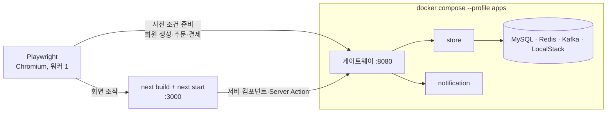

# E2E 테스트

Playwright로 프론트 프로덕션 빌드를 띄우고, 목 서버 없이 **실제 백엔드 전체**에 붙여 화면을 검증합니다. 확인하려는 것은 "두 저장소가 실제로 맞물리는가"입니다.

## 결과

| 항목 | 값 (직접 셈) |
|---|---|
| 시나리오 파일 | 6개 (`e2e/*.spec.ts`) + 공용 도구 1개 |
| 시나리오 | 20개 |
| 마지막 로컬 실행 (2026-10-20) | 19개 통과, 1개 건너뜀 |
| 코드 | 645줄 |

E2E로 찾은 프론트 버그는 없었습니다. 대신 백엔드 설정 문제 두 가지를 찾아 백엔드 카드(T28)로 넘겼습니다(아래 "건너뛰는 시나리오").

## 실행 구조

| 결정 | 이유 |
|---|---|
| 목 서버를 두지 않는다 | 목으로는 스펙과 실제 응답의 차이(발급 URL 호스트, 409 문구 등)를 잡을 수 없습니다 |
| 프로덕션 빌드로 띄운다 | 개발 서버는 `'use cache'`와 프리렌더 동작이 달라 태그 무효화 문제를 가립니다 |
| `COOKIE_SECURE=false` | http로 띄우므로 `secure` 쿠키가 돌아오지 않는 문제를 피합니다 |
| **사전 조건은 API로, 확인은 화면으로** | 회원 만들기·주문 깔기까지 화면으로 하면 한 시나리오가 다른 화면의 버그에 같이 깨지고 느려집니다 |
| 실행마다 새 회원을 만든다 | DB는 실행 사이에 지워지지 않습니다. 고정 회원은 두 번째 실행부터 "이미 보유"로 막힙니다 |
| 실패 시에만 trace 보관 | 실패 원인을 다시 실행하지 않고 볼 수 있습니다 |
| 브라우저 로케일 `ko-KR`, 시간대 `Asia/Seoul` | 날짜·금액 표시를 고정합니다 |

### 워커를 1개로 둔 이유

워커 수를 정할 당시 게이트웨이 레이트리밋의 키는 요청 IP였습니다. 이후 백엔드 T27에서 로그인한 요청은 세션 기준으로 바뀌었지만, 비로그인 요청은 지금도 클라이언트 IP 기준입니다. E2E에서는 모든 API 호출이 Next 서버 한 곳에서 나갑니다. 병렬로 돌리면 테스트끼리 같은 한도를 나눠 쓰다가 429로 흔들립니다. 느려지면 워커를 늘리기보다 E2E 환경에서만 게이트웨이 한도를 올리기로 했습니다.

## 시나리오 목록

| 파일 | 시나리오 | 관련 카드 |
|---|---|---|
| `purchase.spec.ts` | 비로그인으로 담고 로그인해 주문·결제하면 라이브러리에 들어온다 | T04, T05 |
| | 보호 화면은 비로그인이면 로그인으로 보내고 로그인 후 돌아온다 | T02 |
| `review-inquiry.spec.ts` | 보유하지 않은 게임에는 리뷰 작성 폼이 없다 | T06 |
| | 리뷰 작성 → 목록 갱신 → 다른 회원 신고 → 관리자 수용 → 리뷰가 가려진다 | T06, T07 |
| | 문의 등록 → 상세 이동 → 관리자 답변 → 사용자가 답변을 본다 | T06, T07 |
| `admin.spec.ts` | 비로그인은 로그인으로, 일반 회원은 404로 막힌다 | T07 |
| | 관리자가 게임을 등록하고 판매를 시작하면 카탈로그에 보인다 | T07 |
| | 관리자 이미지 업로드: presigned URL로 브라우저가 스토리지에 직접 PUT 한다 (건너뜀) | T07 |
| | 관리자가 회원을 닉네임으로 찾아 정지하고 해제한다 | T07 |
| `birth-date.spec.ts` | 가입 폼에서 생년월일을 넣으면 내 정보에 "등록됨"으로 보인다 | T11 |
| | 생년월일 없는 회원이 연령 등급 게임을 주문하면 등록으로 안내되고, 등록 후 주문된다 | T11 |
| | 연령 미달은 등록 링크 없이 백엔드 문구만 보인다 | T11 |
| `orders.spec.ts` | 주문이 13건이면 번호 페이징으로 2페이지까지 보인다 (페이지 크기 12) | T12 |
| | 목록에서 결제 대기 주문을 취소하면 "취소됨"으로 바뀐다 | T12 |
| | 상세에서 결제 대기 주문을 취소하면 취소 안내가 보인다 | T12 |
| | 다른 곳에서 결제된 주문을 취소하면 409 문구가 보이고 화면은 그대로다 | T12 |
| | 이미 보유한 게임을 다시 주문하면 게임 제목이 담긴 문구가 보인다 | T12 |
| `errors.spec.ts` | 가입 폼의 형식 검증 오류가 해당 칸에 붙는다 | T13 |
| | 도메인 규칙 위반은 백엔드 문구가 폼 위에 보인다 | T13 |
| | 틀린 비밀번호로 로그인하면 오류 문구가 보인다 | T13 |

핵심 구매 흐름 하나가 여러 결정을 함께 검증합니다. 비로그인 담기(장바구니 쿠키), 주문 시 401 → 로그인 → 장바구니 복귀(`next` 검증), 결제 전 주문에 결제 시각이 없음(`paidAt: null`), PG 미연동 안내 문구, 결제 후 라이브러리 적재와 상세 화면의 "보유 중" 표시까지 한 시나리오에서 봅니다.

## 건너뛰는 시나리오

!!! warning "관리자 이미지 직접 업로드"
    브라우저가 presigned URL로 스토리지에 직접 올리려면 백엔드 쪽 설정 두 가지가 필요한데 둘 다 없었습니다.

    1. compose 환경의 store가 업로드 URL을 **컨테이너 내부 호스트 이름**으로 서명합니다. 브라우저는 그 이름을 찾지 못합니다.
    2. 로컬 버킷에 **CORS 설정이 없어** 사전 요청(OPTIONS)이 403입니다.

    프론트로는 고칠 수 없어서 원인을 적고 `test.skip`으로 건너뜁니다. 건너뛰기 조건은 실제 응답(URL 호스트, 사전 요청 결과)을 보므로, 백엔드가 고쳐지면 테스트가 저절로 돕니다. 이 문제는 백엔드 T28 범위에 넣었습니다. 그 사이 판매 시작 흐름은 대표 이미지를 API로 붙여 검증했습니다.

## CI

CI는 `verify`(타입체크·린트·포맷·빌드, 백엔드 없음)와 `e2e` 두 잡으로 나눴습니다. `e2e` 잡은 백엔드 저장소를 받아 `docker compose --profile apps`로 띄운 뒤 Playwright를 실행하고, 실패하면 백엔드 로그와 리포트를 남깁니다.

!!! note "아직 CI에서는 건너뜀"
    백엔드 저장소가 비공개라 읽기 토큰 시크릿이 있어야 받아 올 수 있습니다. 시크릿이 없으면 `e2e` 잡은 실패하지 않고 "건너뜀" 안내만 남깁니다. 시크릿 등록은 사람이 할 일로 남겼습니다. 그래서 위 결과는 로컬 실행 기준이고, T09 카드는 검토 중 상태입니다.

## 관련 문서

- [프론트엔드 개요](index.md)
- [데이터 가져오기·캐시·인증](data-fetching.md)
- [API 계약과 타입 생성](api-contract.md)
- [품질을 지키는 방법](../engineering/quality.md)
- [트러블슈팅 3: 가끔 실패하는 레이트리밋 테스트](../troubleshooting/03-flaky-rate-limit-test.md)
