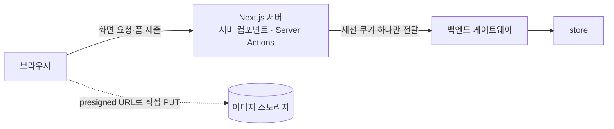
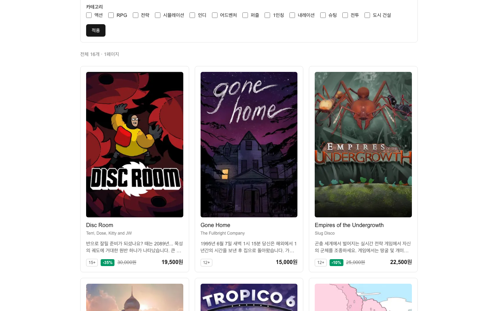
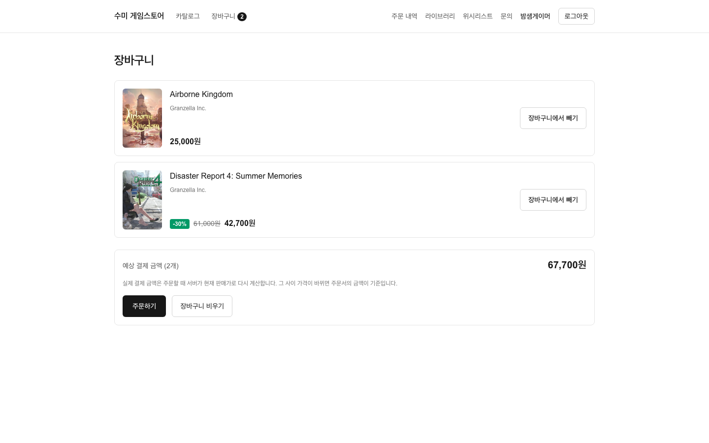
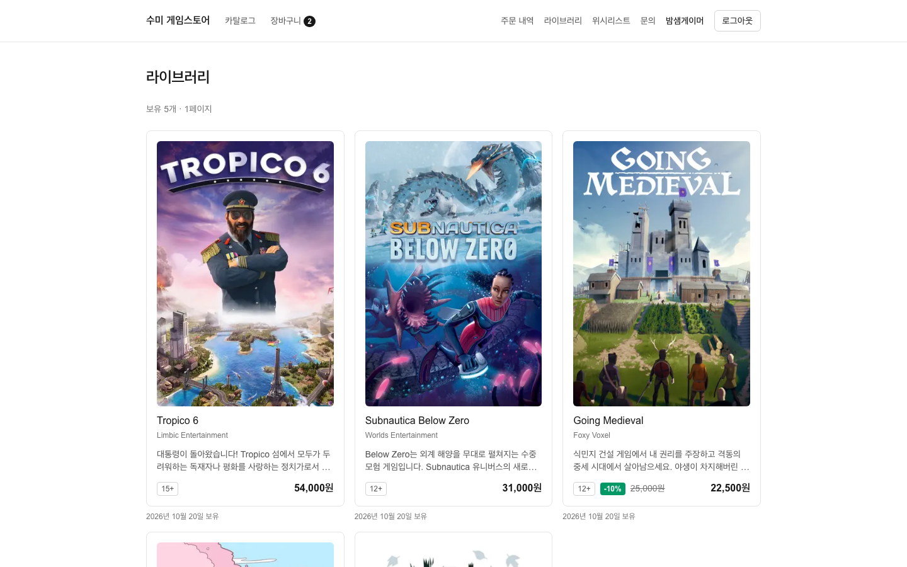
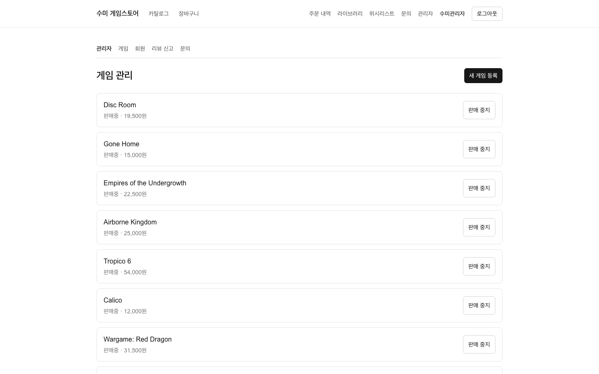
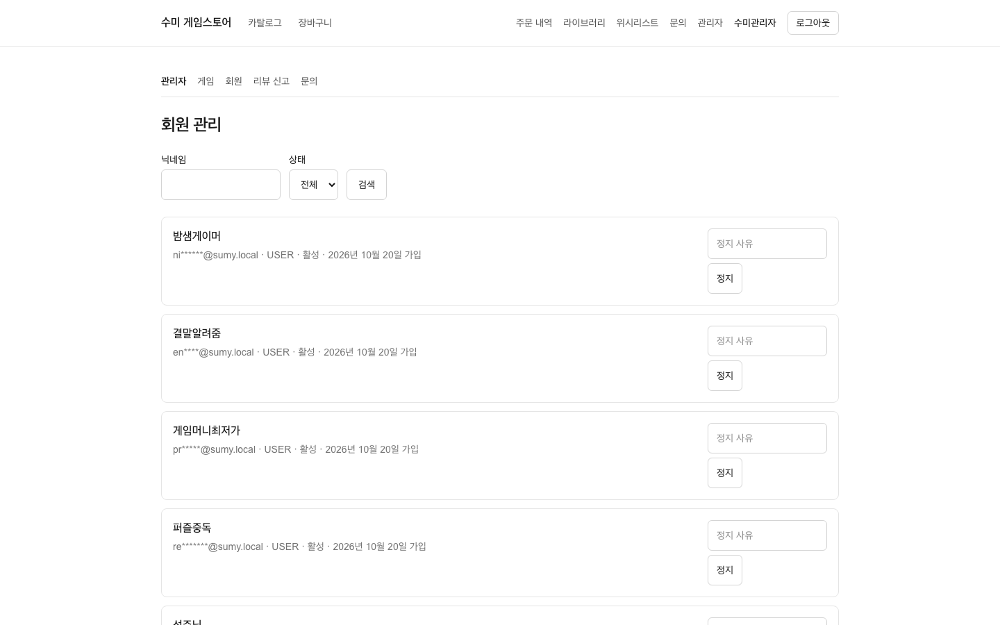

# 프론트엔드 개요

Next.js App Router로 만든 게임 스토어 화면입니다. 백엔드와 저장소를 나눴고, 두 저장소를 잇는 것은 OpenAPI 스펙 하나뿐입니다.

## 스택

| 항목 | 버전·도구 | 비고 |
|---|---|---|
| 프레임워크 | Next.js 16.3 (App Router) | Turbopack 기본, `cacheComponents` 켬 |
| UI | React 19.2 | 기본은 서버 컴포넌트 |
| 언어 | TypeScript 5 | `next typegen` + `tsc --noEmit`로 라우트 타입까지 검사 |
| 스타일 | Tailwind CSS 4 | `@tailwindcss/postcss`, Prettier 플러그인으로 클래스 정렬 |
| API 타입 | openapi-typescript 7 | 백엔드 스펙에서 타입 생성 |
| E2E | Playwright 1.64 | 실제 백엔드에 붙여 실행 |
| 품질 | ESLint 9, Prettier 3 | `npm run verify` = 타입체크 + 린트 + 포맷 + 빌드 |

런타임 의존성은 `next`, `react`, `react-dom` 세 개뿐입니다. 상태 관리 라이브러리와 데이터 페칭 라이브러리를 쓰지 않습니다. 서버 컴포넌트와 Server Actions(서버 액션), Next의 캐시로 충분했기 때문입니다.

## 구조



**API는 서버에서만 부릅니다.** 브라우저가 백엔드를 직접 부르지 않으므로 백엔드 주소가 클라이언트 번들에 들어가지 않고, CORS를 따로 다룰 필요가 없고, 세션이 브라우저 자바스크립트에 노출되지 않습니다. 예외는 관리자 이미지 업로드 하나입니다. 파일 본문이 Next 서버를 거치지 않도록 브라우저가 presigned URL로 스토리지에 직접 올립니다.

## 폴더 구조

```text
src/
├── proxy.ts                 보호 경로 1차 관문 (Next 16에서 middleware.ts의 새 이름)
├── app/                     라우트. 페이지는 서버 컴포넌트
│   ├── games/               카탈로그·상세 (_components, _lib, actions.ts)
│   ├── cart/                장바구니·주문하기
│   ├── orders/              주문 목록·상세·결제 확정
│   ├── library/  wishlist/  보유 게임·위시리스트
│   ├── inquiries/           문의 목록·작성·상세
│   ├── account/             내 정보(생년월일 등록)
│   ├── login/  signup/      로그인·회원가입
│   └── admin/               관리자: 게임·회원·신고·문의
├── components/              재사용 컴포넌트 (오류 안내, 페이지 이동, 토글 버튼 등)
└── lib/
    ├── api/
    │   ├── schema.d.ts      OpenAPI 스펙에서 생성한 타입 (손으로 고치지 않음)
    │   ├── client.ts        fetch 래퍼. 게이트웨이 한 곳만 부른다
    │   ├── errors.ts        ProblemDetail 해석, ApiError, LoadResult
    │   └── <도메인>.ts       games, orders, reviews 등 도메인별 호출과 loadXxx()
    ├── cart.ts              장바구니 쿠키 읽기
    ├── *-actions.ts         여러 화면이 함께 쓰는 Server Actions
    └── session.ts           세션 쿠키 이름, 로그인 후 돌아갈 경로 검증
e2e/                         Playwright 시나리오
openapi/store.json           백엔드 스펙 스냅샷 (커밋함)
scripts/openapi-*.mjs        스펙 받기·타입 생성
```

규모(직접 셈): `src/` 아래 TypeScript 파일 90개, 6,579줄입니다. 생성 파일 `schema.d.ts`(4,502줄)는 뺀 숫자입니다. `'use client'` 파일은 14개이고 모두 폼이나 토글 버튼처럼 상호작용이 필요한 곳입니다.

## 화면 목록

라우트(`page.tsx`) 21개입니다. "로그인 필요"는 `proxy.ts`의 보호 경로 목록 기준입니다.

| 라우트 | 화면 | 로그인 필요 |
|---|---|---|
| `/` | 홈 | 아니요 |
| `/games` | 카탈로그(검색·카테고리·가격 필터·정렬·페이징) | 아니요 |
| `/games/[id]` | 게임 상세, 리뷰 목록·작성·신고, 담기 | 아니요 (리뷰 작성 폼은 보유자에게만) |
| `/cart` | 장바구니, 주문하기 | 아니요 (주문 시점에 로그인 요구) |
| `/login` | 로그인 | 아니요 |
| `/signup` | 회원가입 | 아니요 |
| `/account` | 내 정보, 생년월일 등록 | 예 |
| `/orders` | 주문 내역(번호 페이징, 결제 전 주문 취소) | 예 |
| `/orders/[id]` | 주문 상세, 결제 확정 | 예 |
| `/library` | 보유 게임 | 예 |
| `/wishlist` | 위시리스트 | 예 |
| `/inquiries` | 내 문의 | 예 |
| `/inquiries/new` | 문의하기 | 예 |
| `/inquiries/[id]` | 문의 상세와 답변 | 예 |
| `/admin` | 관리자 홈 | 예 (관리자) |
| `/admin/games` | 게임 관리 목록 | 예 (관리자) |
| `/admin/games/new` | 게임 등록 | 예 (관리자) |
| `/admin/games/[id]` | 게임 수정, 판매 상태 변경, 이미지 업로드 | 예 (관리자) |
| `/admin/members` | 회원 찾기, 정지·해제 | 예 (관리자) |
| `/admin/reports` | 리뷰 신고 처리 | 예 (관리자) |
| `/admin/inquiries` | 문의 답변·종료 | 예 (관리자) |

| 카탈로그 | 장바구니 | 라이브러리 |
|---|---|---|
|  |  |  |

| 관리자: 게임 목록 | 관리자: 회원 |
|---|---|
|  |  |

## 지키는 규칙

| 규칙 | 이유 |
|---|---|
| 백엔드가 꺼져 있어도 빌드가 통과하고 화면이 죽지 않는다 | CI에 백엔드가 없습니다. API 실패는 판별 유니온(`LoadResult`)으로 받아 화면에서 분기합니다 |
| `'use client'`는 상호작용이 필요할 때만 | 번들을 줄이고 데이터 호출을 서버에 둡니다 |
| 금액·할인을 프론트에서 계산하지 않는다 | 서버가 판매가를 내려 줍니다. 장바구니 합계는 "예상 결제 금액"으로만 표시합니다 |
| JSX를 try/catch 안에서 만들지 않는다 | 자식 렌더 중 예외까지 삼킵니다. ESLint로 막습니다 |
| 서버 전용 값에 `NEXT_PUBLIC_`을 붙이지 않는다 | 클라이언트 번들로 새지 않게 합니다 |

!!! note "Next.js 16에서 달라진 점"
    `params`·`searchParams`가 Promise가 됐고, `middleware.ts`가 `proxy.ts`로 이름이 바뀌었고, `fetch`는 기본으로 캐시하지 않습니다. 학습 자료와 다른 부분이 많아서, 코드를 쓰기 전에 설치된 버전의 공식 문서(`node_modules/next/dist/docs/`)를 근거로 삼았습니다.

## 진행 상태

| 상태 | 카드 |
|---|---|
| 완료 | T01 타입 생성, T02 로그인·세션, T03 카탈로그, T04 장바구니·결제, T05 라이브러리·위시리스트, T06 리뷰·문의, T07 관리자, T10 캐시 오류 처리, T11 생년월일, T12 주문 목록·취소, T13 스펙 타입 정리 |
| 검토 중 | T09 E2E |
| 보류 | T08 국제화 (백엔드 로케일이 한국어 고정이라 선행 조건 미충족) |

자세한 순서는 [작업 이력](../history/index.md)에 있습니다.

## 관련 문서

- [데이터 가져오기·캐시·인증](data-fetching.md)
- [API 계약과 타입 생성](api-contract.md)
- [E2E 테스트](e2e.md)
- [백엔드 아키텍처](../backend/architecture.md)
- [트러블슈팅 4: API 스펙과 실제 응답의 차이](../troubleshooting/04-spec-vs-response.md)
