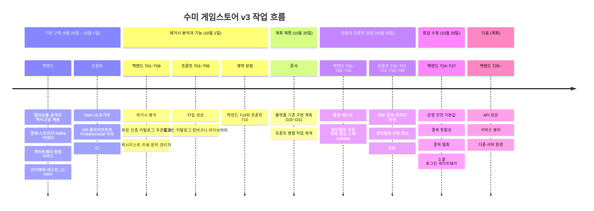

# 작업 이력

두 저장소의 작업을 시간순으로 정리했습니다. 작업은 파일 하나가 카드 하나인 칸반으로 관리했고, **카드 하나 = 커밋 하나 = 푸시 하나**가 원칙입니다. 표의 내용은 각 카드의 목표와 구현 메모, 커밋 기록에서 가져왔습니다.

## 흐름

!!! note "커밋 번호와 카드 번호"
    칸반을 만들기 전(9월 24일 ~ 10월 1일 오전)의 기반 커밋에도 "T01~T28" 번호가 붙어 있습니다. 이 번호는 아래 표의 카드 번호와 다릅니다. 아래 표는 `tasks/` 폴더의 카드 번호 기준입니다.

## 기반 구축 (카드 체계 이전)

| 날짜 | 저장소 | 내용 |
|---|---|---|
| 9월 24일 ~ 26일 | 백엔드 | Gradle 멀티모듈 골격과 버전 카탈로그, 공통 오류 타입·이벤트 계약, 도메인·애플리케이션 계층, Flyway 기준 스키마, JPA·웹·S3·PG·Kafka 어댑터 |
| 9월 30일 | 백엔드 | 알림 서비스(Kafka 컨슈머 + R2DBC + 메일), 게이트웨이(WebFlux 라우팅 + Redis 레이트리밋), 헥사고날 아키텍처 테스트(Konsist) |
| 10월 1일 | 백엔드 | 로컬 환경·CI·배포 매니페스트, 규칙서·결정 기록·칸반, 어댑터 모듈 통합, Kotlin JDSL 전환, 요청 객체·springdoc, 로컬 S3를 LocalStack으로 교체, 다국어 제거, 카드 사이클 자동화 스크립트 |
| 9월 24일 ~ 26일 | 프론트 | Next 16 초기화, 백엔드 API 클라이언트와 ProblemDetail 오류 처리, 카탈로그 정적 틀 + Suspense 스트리밍 |
| 10월 1일 | 프론트 | 백엔드 없이 통과하는 CI, 규칙서·결정 기록·칸반, Next 생성 라우트 타입 |

## 백엔드 카드

| 카드 | 날짜 | 제목 | 한 줄 요약 | 주요 결과 |
|---|---|---|---|---|
| T01 | 10-01 | 레거시 분석 문서화 | 도메인 8개를 해부해 이관·폐기 판단과 기술 부채를 근거와 함께 기록 | 스키마 문제 43건, 자격 증명 18건, 주문·결제 폐기 판단 |
| T02 | 10-01 | 회원 도메인 + 가입 | 레거시 회원 테이블을 버리고 재설계. 소셜 전용 계정은 비밀번호 없음 | 테스트 96개 |
| T03 | 10-01 | 폼 로그인 + 소셜 로그인 | Spring Security 공식 OAuth2 클라이언트로 카카오·네이버, Redis 세션 | 테스트 105개 |
| T04 | 10-01 | 카탈로그 관리 API + 이미지 업로드 | 등록은 항상 초안, 판매 시작 조건 검사, presigned URL 업로드 | 카테고리·이미지 고정 칸 제거 |
| T05 | 10-01 | 주문 + 결제 | 서버 금액 계산, 가격 스냅샷, PG 실결제액 대조, 콜백 멱등 처리 | 레거시 폐기 영역 재설계 |
| T06 | 10-01 | 위시리스트 + 라이브러리 | 장바구니 겸용을 분리하고 구매 시 위시리스트 자동 정리 | 유니크 제약 추가 |
| T07 | 10-01 | 리뷰 + 신고 | 보유자만 리뷰, 좋아요·신고를 행으로, 경고 카운터를 제재 이력으로 | 도메인 테스트 34개 추가 |
| T08 | 10-01 | 문의 + 뉴스 | 앞 카드의 관용구를 그대로 적용한 단순 기능 | 테스트 217개 |
| T09 | 10-01 | 관리자 API + 권한 | 관리자 API를 모으고 모든 관리자 엔드포인트의 401·403을 자동 순회 검사 | 테스트 239개, 관리자 엔드포인트 31개 전수 |
| T19 | 10-01 | API 응답 타입·스펙 보정 (프론트 요청) | 자유형 맵 응답을 DTO로, 오류 응답 스키마를 ProblemDetail로 전수 교정 | D17·D18·D19 |
| T10 | 10-20 | 통합 테스트 + Docker 검증 | Testcontainers로 구매 흐름·이벤트·알림 멱등성 검증, 이미지와 Helm 실제 기동 | 테스트 267개 |
| T20 | 10-20 | 회원 생년월일 등록 (프론트 요청) | 앱 가입 회원도 연령 등급 게임을 살 수 있게 등록 API와 409 `type` 구분 | 테스트 290개, D32 |
| T21 | 10-20 | 주문 목록 페이지 봉투 (프론트 요청) | 주문 목록을 공통 페이지 응답으로, 보유 409 문구에 게임 제목 | 테스트 295개, D33 |
| T22 | 10-20 | 미결제 주문 취소 API (프론트 요청) | 결제 전 주문 취소, 재요청은 멱등 처리 | 테스트 305개, D34 |
| T23 | 10-20 | 스펙 nullable + ProblemDetail 확장 (프론트 요청) | 내장 코틀린 nullable 처리 복구, 오류 스키마를 실제 응답 타입에서 생성 | null 표시 35곳, D35 |
| T24 | 10-20 | 운영 안전 | 시드는 로컬에서만, 운영 기본값은 안전한 쪽, PG 키가 없으면 운영 기동 거부 | D36 |
| T25 | 10-20 | 결제 정합성 | 이중 결제 자동 취소, 실패 기록, PG 타임아웃, 확정·취소 직렬화 | 테스트 369개, D38 |
| T26 | 10-20 | 결제 웹훅 + 미확정 주문 대사 | 공식 SDK로 서명 검증, ShedLock 스케줄로 대사 | 웹훅 통합 테스트 10개, D39 |
| T27 | 10-20 | 소셜 로그인·게이트웨이 수정 | 인증 주체 통일, 정지 시 세션 회수, 게이트웨이 경유 소셜 로그인, 레이트리밋 키 | D40, 현재 테스트 416개 |

백엔드 테스트 수는 96개(T02)에서 416개(T27 이후)로 늘었습니다. 416개는 최근 테스트 실행 보고서를 직접 합산한 값이고, 나머지는 각 카드 기록의 값입니다.

## 프론트엔드 카드

| 카드 | 날짜 | 제목 | 한 줄 요약 | 주요 결과 |
|---|---|---|---|---|
| T01 | 10-01 | OpenAPI 타입 생성 | 손으로 맞추던 API 타입을 스펙 생성물로 교체, 스펙·생성물 커밋 | D07 |
| T02 | 10-01 | 로그인 + 세션 | 세션 쿠키를 다시 심는 방식, proxy + 페이지 두 겹 보호, `next` 검증 | D12·D13·D14 |
| T03 | 10-01 | 카탈로그 완성 | 썸네일·스크린샷·페이징·카테고리·가격 필터 | D10·D11 |
| T05 | 10-01 | 라이브러리 + 위시리스트 | 상세 화면의 보유·담기 상태, 사용자별 변경은 `refresh()` | D15 |
| T10 | 10-01 | 캐시된 로더의 오류 처리 복구 | 캐시 경계에서 사라지던 `ApiError`를 값으로 돌려받도록 수정 | D16 |
| T04 | 10-01 | 장바구니 + 결제 | 서버가 읽는 쿠키 장바구니, PG 미연동 사실을 화면에 표시 | D17·D18 |
| T08 | 10-20 | 국제화 | 백엔드 로케일이 한국어 고정이라 선행 조건 미충족 | **보류** |
| T06 | 10-20 | 리뷰 + 문의 | 리뷰 목록은 공용 캐시 + 태그 무효화, 작성 폼은 보유자에게만 | D19 |
| T07 | 10-20 | 관리자 화면 | 게임 등록·이미지 업로드·회원·신고·문의 관리, 일반 회원은 404 | D20 |
| T11 | 10-20 | 생년월일 등록 | `/account` 화면, 409 `type`으로 등록 안내 분기 | D21 |
| T12 | 10-20 | 주문 목록 페이징 + 취소 | 번호 페이징과 결제 전 주문 취소 | 백엔드 T21·T22 연동 |
| T13 | 10-20 | 스펙 nullable·오류 타입 정리 | 손으로 쓴 오류 타입과 null 우회 코드 제거 | 백엔드 T23 연동 |
| T09 | 10-20 | E2E 테스트 | 실제 백엔드에 붙인 Playwright 시나리오 20개 | 19 통과·1 건너뜀, D22, **검토 중** |

T10은 번호가 뒤지만 T04보다 먼저 처리했습니다. "백엔드가 꺼져도 화면이 죽지 않는다"는 절대 규칙 위반이었고, 뒤 카드들이 같은 코드 패턴을 복제하기 전에 막아야 했기 때문입니다.

## 두 저장소를 맞물린 방식

프론트 카드가 백엔드 API를 필요로 하면 백엔드에 "프론트 요청" 카드를 만들고, 그 카드가 검토 단계에 오른 뒤 스펙을 내보내 프론트 카드를 시작했습니다(백엔드 D31).

| 프론트에서 찾은 문제 | 백엔드 카드 | 프론트 카드 |
|---|---|---|
| 자유형 맵 응답, 오류 스키마 오기 | T19 | T02 후속, T10 |
| 앱 가입 회원이 연령 등급 게임을 못 삼 | T20 | T11 |
| 주문 목록이 배열이라 페이징 불가 | T21 | T12 |
| 미결제 주문이 쌓이기만 함 | T22 | T12 |
| nullable 표시 누락(1970년 날짜) | T23 | T13 |
| 업로드 URL 호스트, 버킷 CORS | T28 (계획) | T09에서 발견 |

## 현재 상태 (2026-10-20)

| 저장소 | 완료 | 검토 중 | 보류 | 다음 |
|---|---|---|---|---|
| 백엔드 | 19장 | 0 | 0 | T28 API 보강, T29 관리자 조회 API, T30~ 서비스 분리 |
| 프론트 | 11장 | 1장 (T09) | 1장 (T08) | T14 소셜 로그인 화면 |

## 관련 문서

- [결정 기록 색인](decisions.md)
- [프로젝트 소개](../overview/index.md)
- [로드맵](../overview/roadmap.md)
- [AI 협업 방식](../engineering/ai-workflow.md)
- [API 계약과 타입 생성](../frontend/api-contract.md)
