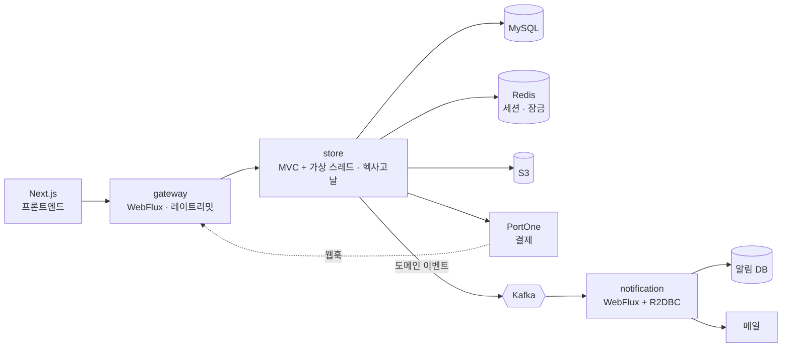

# 수미 게임스토어 v3

예전에 만든 게임 쇼핑몰(Java 8, Spring Boot 2.7, JSP, MyBatis)을 **Kotlin과 Spring Boot 4로 처음부터 다시 만들고 있는** 개인 프로젝트의 위키입니다.
구조를 다시 짜고, 결제·동시성·운영처럼 실제 서비스에서 문제가 되는 부분을 테스트로 증명하는 데 집중했습니다.

!!! info "코드 열람"
    코드는 비공개입니다. 이 위키에는 설계, 판단 근거, 실제로 겪은 문제를 정리했습니다.
    코드 열람이 필요하시면 요청해 주세요. 비공개 저장소의 읽기 권한을 드리겠습니다.

## 한눈에 보기

| 항목 | 내용 |
|---|---|
| 기간 | 2026년 9월 ~ 진행 중 |
| 구성 | 백엔드 3개 서비스(게이트웨이·스토어·알림) + Next.js 프론트엔드 |
| 백엔드 | Kotlin 2.2 · Spring Boot 4.0 · Spring Cloud Gateway · JPA + Kotlin JDSL · Kafka · Redis · MySQL |
| 프론트엔드 | Next.js 16 · React 19 · TypeScript · OpenAPI 스펙에서 생성한 타입 |
| 테스트 | 백엔드 테스트 416개, 실제 기동 후 API 확인 130여 항목, 프론트 E2E 20개 시나리오 |
| 배포 | Docker · Helm(EKS 기준) · GitHub Actions |

## 이 프로젝트에서 보여 드리고 싶은 것

-   **구조를 빌드가 지키게 했습니다**

    ---

    헥사고날 의존 방향을 Gradle 모듈 경계와 아키텍처 테스트로 막습니다. 규칙을 어기면 빌드가 실패합니다.

    [:octicons-arrow-right-24: 모듈 구조](backend/modules.md)

-   **돈이 새는 경우를 테스트로 재현하고 막았습니다**

    ---

    이중 결제, 확정과 취소의 경합, 느린 PG 응답을 각각 테스트로 재현한 뒤 보상 취소와 잠금으로 해결했습니다.

    [:octicons-arrow-right-24: 이중 결제](troubleshooting/02-double-payment.md)

-   **실제로 띄워서 확인합니다**

    ---

    커밋 전마다 전체를 띄워 API를 호출합니다. 컴파일은 되는데 컨테이너가 뜨지 않는 문제를 이렇게 찾았습니다.

    [:octicons-arrow-right-24: 실제로 띄우니 안 됐다](troubleshooting/01-it-compiles-but.md)

-   **판단을 기록으로 남깁니다**

    ---

    기술을 고를 때마다 "결정 / 근거 / 되돌리는 방법"을 남겼습니다. 지금까지 40건입니다.

    [:octicons-arrow-right-24: 기술 결정](engineering/tech-decisions.md)

-   **AI와 협업하는 개발 체계를 설계했습니다**

    ---

    작업 카드, 자동 검증 게이트, 결정 기록을 묶어 AI가 틀려도 결과가 망가지지 않게 했습니다.

    [:octicons-arrow-right-24: AI 협업](engineering/ai-workflow.md)

-   **레거시를 분석하고 다시 설계했습니다**

    ---

    평문 비밀값, 고정 컬럼 스키마, 조건이 빠지는 쿼리 같은 문제를 찾아 정리하고 재작성의 근거로 삼았습니다.

    [:octicons-arrow-right-24: 레거시 분석](overview/legacy-analysis.md)

## 아키텍처

블로킹이 없는 게이트웨이와 알림 서비스는 WebFlux로, JPA를 쓰는 스토어는 MVC와 가상 스레드로 나눴습니다. 자세한 내용은 [아키텍처](backend/architecture.md)에 있습니다.

## 화면

| 게임 상세와 리뷰 | 관리자: 신고 처리 |
|---|---|
|  |  |

더 많은 화면은 [화면](overview/screens.md)에 있습니다.

## 어디부터 보면 좋을까요

| 시간 | 추천 문서 |
|---|---|
| 3분 | 이 페이지 → [트러블슈팅: 이중 결제](troubleshooting/02-double-payment.md) |
| 10분 | [프로젝트 소개](overview/index.md) → [아키텍처](backend/architecture.md) → [기술 결정](engineering/tech-decisions.md) |
| 30분 | [기능별 문서](backend/domains/index.md) → [품질](engineering/quality.md) → [작업 이력](history/index.md) |
