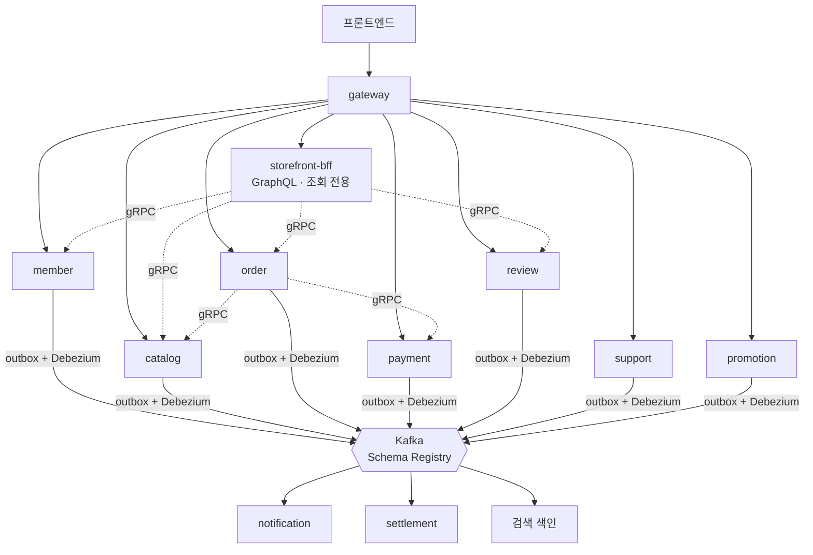

# 로드맵

지금은 3개 서비스(게이트웨이·스토어·알림) 구조로 기능이 동작합니다. 다음 단계에서는 스토어를 업무 단위 서비스로 나누고, 실무에서 쓰는 운영 기술을 실제로 필요한 자리에 붙입니다.

> 아래는 **계획**입니다. 이미 동작하는 것은 [아키텍처](../backend/architecture.md)에 있습니다.

## 목표 구조

| 원칙 | 내용 |
|---|---|
| 서비스마다 자기 DB | 다른 서비스 테이블을 직접 읽지 않습니다 |
| 서비스 안은 멀티모듈 | `core`(도메인 + 유스케이스) / `infra`(기술 구현) / `api`·`admin-api`(실행) |
| 경계는 빌드가 강제 | 서비스 간 Gradle 의존 금지 검사, 새 서비스는 생성 스크립트로만 |
| API 방식 | 기본은 REST. 여러 서비스를 모으는 조회 화면만 GraphQL, 서비스 간 내부 호출은 gRPC |
| 이벤트 | 아웃박스 테이블 + Debezium으로 유실 없이 발행, Avro 스키마 호환성 검사 |

## 단계

| 단계 | 내용 | 주요 기술 |
|---|---|---|
| A. 서비스 분리 | 버전 업그레이드 → 모듈 → 이벤트 → DB → 배포 순으로 나눕니다. API는 바뀌지 않습니다 | Spring Boot 4.1, Spring Modulith, Debezium, gRPC |
| B. 다중 서버 환경 | 모든 서비스를 두 대씩 Docker Compose로 띄우고 E2E로 검증합니다 | nginx, Kafka 3 브로커, MySQL 복제본, Keycloak |
| C. 거래 | CD 키 발급, 주문·환불 사가, 타임딜·선착순 쿠폰, 판매자 정산 | Redis Lua, Redisson, Spring Batch, 복식부기 원장 |
| D. 데이터 | 한글 검색과 유사 게임 추천, 읽기 복제본, 대용량 엑셀 리포트 | Elasticsearch(nori, 벡터), RabbitMQ |
| E. 경험 | GraphQL BFF, AI 리뷰 요약, 패스키 로그인, 상담 채팅, 실시간 순위, 타임딜 대기열, 상담 챗봇 | Spring AI(RAG, MCP), WebSocket, Kafka Streams |
| F. 운영 | 관측, Kubernetes, 공급망 보안, 부하·장애 테스트 | Grafana LGTM, Argo Rollouts, Trivy, k6, Toxiproxy |

## 기술을 넣는 기준
- **그 기술이 없으면 생기는 문제가 실제로 있는 자리**에만 넣습니다. 예를 들어 RabbitMQ는 우선순위와 예약 발송이 필요한 알림 발송 큐에, Kafka Streams는 시간 구간별 판매 순위 집계에 씁니다.
- **표준 라이브러리가 있으면 직접 만들지 않습니다.** 범용 사가 프레임워크, 2단 캐시 같은 것은 만들지 않기로 했습니다.
