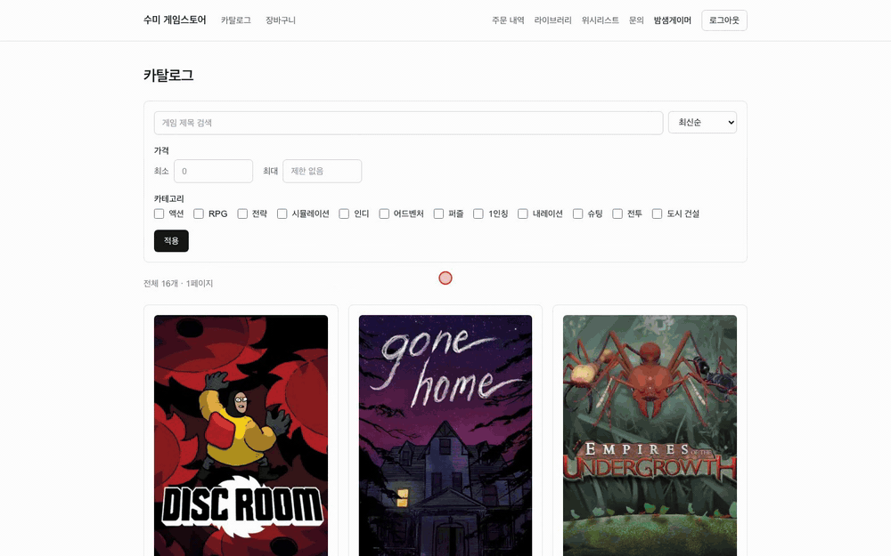
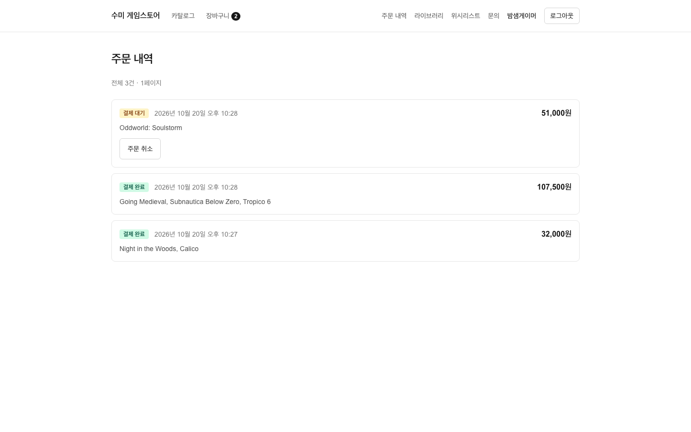
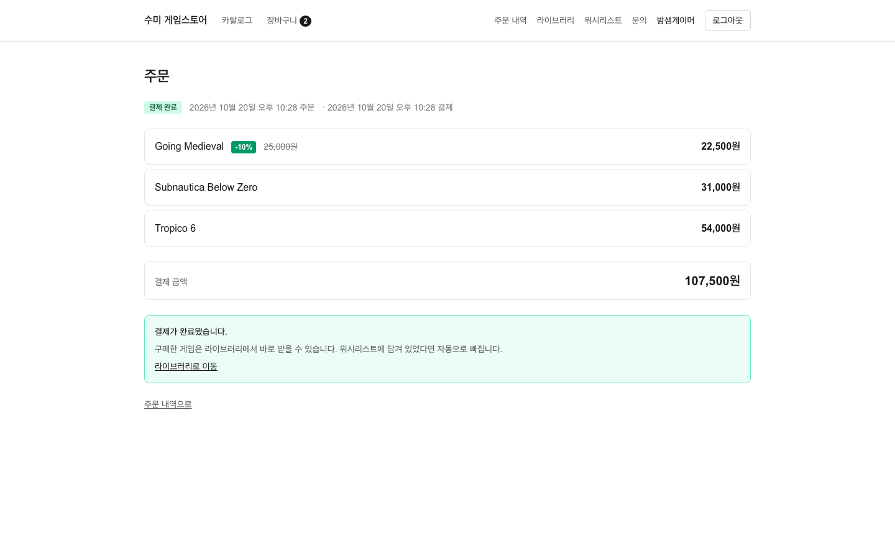
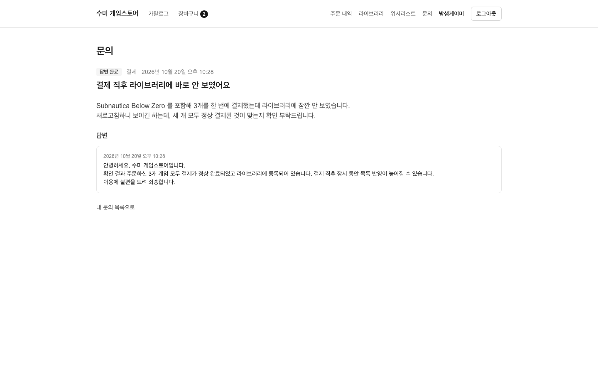
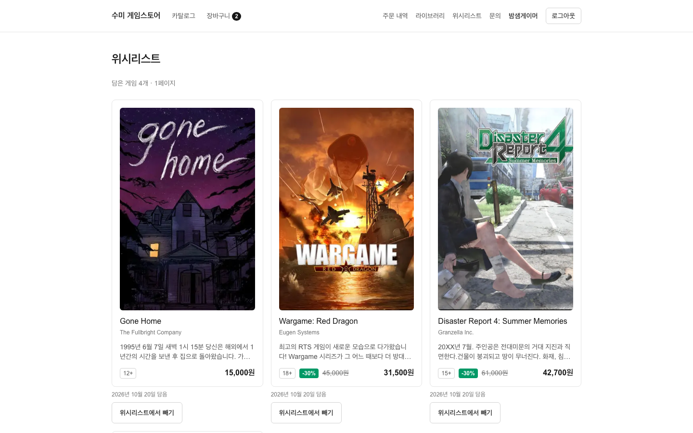
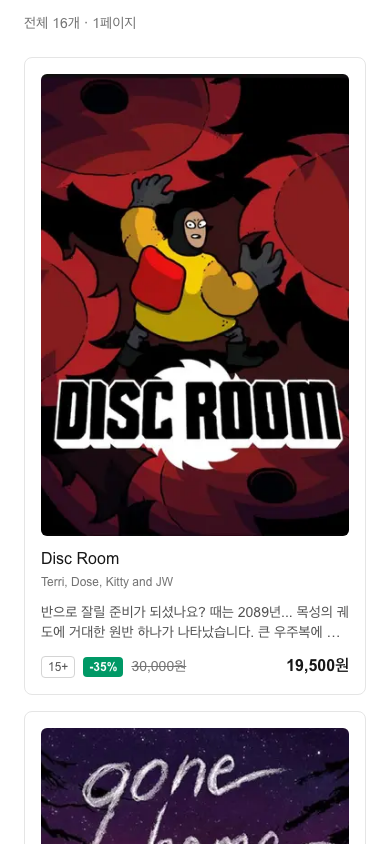
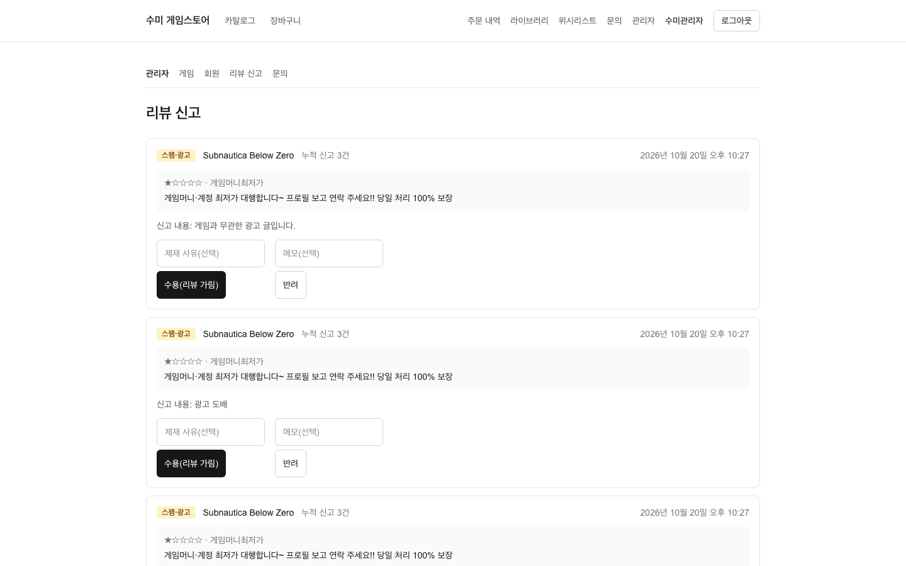
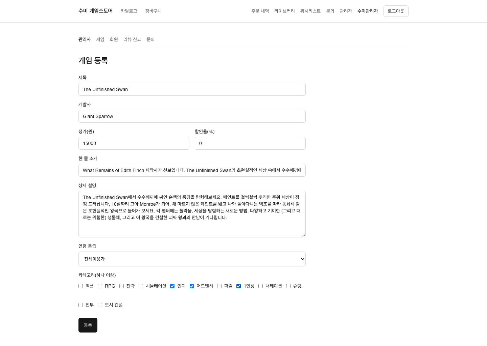

# 화면

로컬 환경(Docker Compose)에서 프론트엔드를 실제 백엔드에 붙여 캡처했습니다. 결제는 테스트용 가짜 결제로 동작하고, 회원·리뷰·주문 데이터는 모두 만든 데이터입니다.

!!! note "게임 이미지 저작권"
    화면의 게임 제목과 이미지는 이전 버전 프로젝트에서 쓰던 자료로, 저작권은 각 게임 개발사·배급사에 있습니다. 포트폴리오 설명 목적으로만 쓰며, 이후 자체 제작 이미지로 바꿀 예정입니다.

## 흐름
| 구매 | 관리자: 신고 수용 → 리뷰 가림 |
|---|---|
|  |  |

## 회원 화면
| 게임 목록 | 게임 상세 |
|---|---|
|  |  |

| 장바구니 | 주문 목록 |
|---|---|
|  |  |

| 주문 상세 | 라이브러리 |
|---|---|
|  |  |

| 문의 상세 | 위시리스트 |
|---|---|
|  |  |

| 모바일 화면 |  |
|---|---|
| { width="320" } |  |

## 관리자 화면
| 게임 관리 | 회원 관리 |
|---|---|
|  |  |

| 리뷰 신고 처리 | 게임 등록 |
|---|---|
|  |  |
