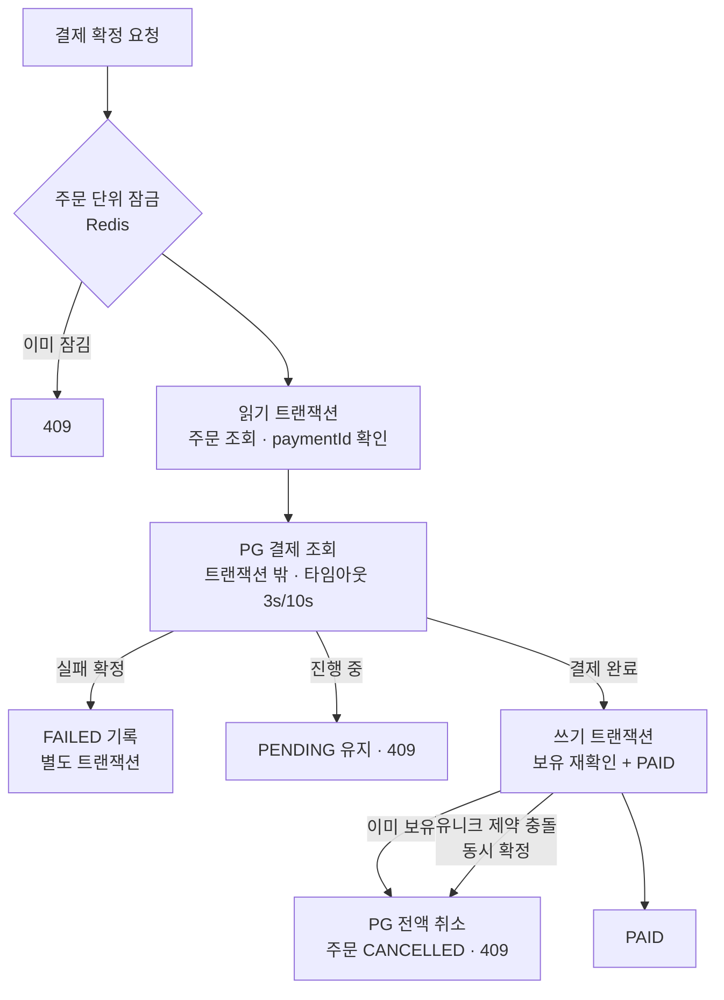

# 2. 같은 게임을 두 번 결제하면 돈이 두 번 빠졌다

## 상황
코드 점검 중에 다음 시나리오를 발견했습니다.

1. 회원이 게임 A를 담아 주문 1을 만들고 결제창을 연다.
2. 결제를 마치기 전에 다른 탭에서 같은 게임으로 주문 2를 만든다.
3. 두 주문을 모두 결제한다.

결제 확정 로직은 **주문을 만들 때만** 보유 여부를 확인했습니다. 그래서 두 결제가 모두 확정됐고, 돈은 두 번 빠졌지만 게임은 한 번만 들어왔습니다.

같은 영역을 살펴보니 비슷한 문제가 더 있었습니다.
- **실패 기록이 사라짐**: PG가 실패를 알려 와 주문을 `FAILED`로 바꾼 뒤 예외를 던지면, 같은 트랜잭션이라 `FAILED` 기록까지 롤백됐습니다.
- **진행 중을 실패로 처리**: 가상계좌처럼 승인이 늦는 결제를 실패로 굳히면, 나중에 돈이 들어와도 주문을 살릴 수 없습니다.
- **취소와 확정이 동시에 들어옴**: 결제 대기 주문을 취소하는 순간 결제 확정이 들어오면, 나중에 저장한 쪽이 이겼습니다. 결제는 됐는데 주문은 취소로 남을 수 있었습니다.
- **PG가 느릴 때**: 타임아웃이 없어서, PG가 응답하지 않으면 요청 스레드와 DB 커넥션을 붙잡고 있었습니다.

## 먼저 테스트로 재현했다
돈이 걸린 코드라 고치기 전에 각 경우를 테스트로 먼저 재현했습니다.
- PG는 WireMock으로 흉내 냈습니다. 정상 승인, 실패 확정, 진행 중, 타임아웃, 5xx, 깨진 응답 본문까지 25개 경우를 만들었습니다.
- 실제 MySQL·Redis에 붙는 통합 테스트로 순차 이중 결제, **동시** 이중 결제, 취소와 확정의 경합을 재현했습니다. 동시성 테스트는 반복 실행해 결과가 흔들리지 않는 것을 확인했습니다.

## 해결

1. **확정 시점에 보유를 다시 확인합니다.** 이미 보유한 게임이면 PG 결제를 전액 취소하고 주문을 닫습니다. 두 확정이 정말 동시에 들어오면 `보유 게임(회원, 게임)` 유니크 제약이 한쪽을 실패시키고, 실패한 쪽이 새 트랜잭션에서 다시 읽어 같은 방식으로 취소합니다.
2. **트랜잭션을 나눴습니다.** 읽기 → PG 조회(트랜잭션 밖) → 쓰기 순서입니다. PG가 느려도 DB를 붙잡지 않고, 실패 기록이 롤백되지 않습니다.
3. **PG 상태를 세 갈래로 나눴습니다.** 결제 완료, 진행 중, 실패 확정입니다. 실패가 확정됐을 때만 `FAILED`로 바꿉니다.
4. **확정과 취소를 같은 잠금으로 직렬화했습니다.** Redis 주문 단위 잠금을 쓰고, 잠금이 만료되거나 유실돼도 막히도록 DB 낙관적 락(`@Version`)을 마지막 방어선으로 두었습니다.
5. **타임아웃과 오류를 분류했습니다.** 연결 3초, 읽기 10초입니다. 타임아웃과 5xx는 503으로 응답하고 주문은 그대로 둬서, 다시 시도하면 확정됩니다.
6. **남의 결제를 건드리지 못하게 했습니다.** 요청의 결제 ID가 주문에 부여된 값과 다르면 PG를 부르기 전에 거절합니다.

## 대안과 선택 이유
"회원·게임당 대기 주문은 하나만"으로 막는 방법도 있었습니다. 하지만 이 방법은 결제창을 닫고 다시 시도하는 정상 사용자를 막고, 기존 대기 주문을 재사용하는 새 API가 필요해 프론트엔드까지 바뀝니다. 확정 시점 재확인과 보상 취소는 PG사 연동 가이드가 권하는 "서버 검증에 실패하면 결제를 취소한다"와 같은 방식이고, API 응답도 바뀌지 않아 이쪽을 택했습니다.

## 그 뒤에 붙인 것
- **결제 웹훅**: 사용자가 결제 직후 브라우저를 닫아도 PG의 웹훅으로 주문을 확정합니다. 서명은 공식 SDK로 검증하고, 본문은 믿지 않고 PG에 다시 조회합니다. 같은 웹훅이 두 번 와도 한 번만 처리합니다.
- **대사 작업**: 10분이 지나도 확정되지 않은 주문은 1분마다 PG에 조회해 확정합니다. 24시간이 지나도 결제되지 않은 주문은 취소합니다. 여러 인스턴스 중 한 곳에서만 돌도록 ShedLock을 걸었습니다.

## 배운 점
결제는 성공 경로보다 **실패, 지연, 동시성 경로**에서 사고가 납니다. 외부 호출을 트랜잭션 밖으로 빼고, 실패 상태를 정확히 나누고, 잠금 위에 DB 제약이라는 마지막 방어선을 하나 더 두는 것이 핵심이었습니다.
